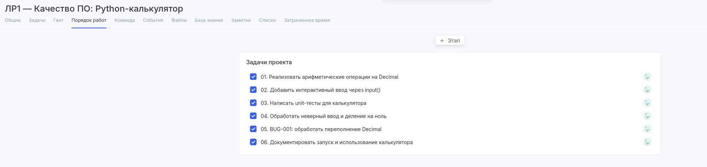
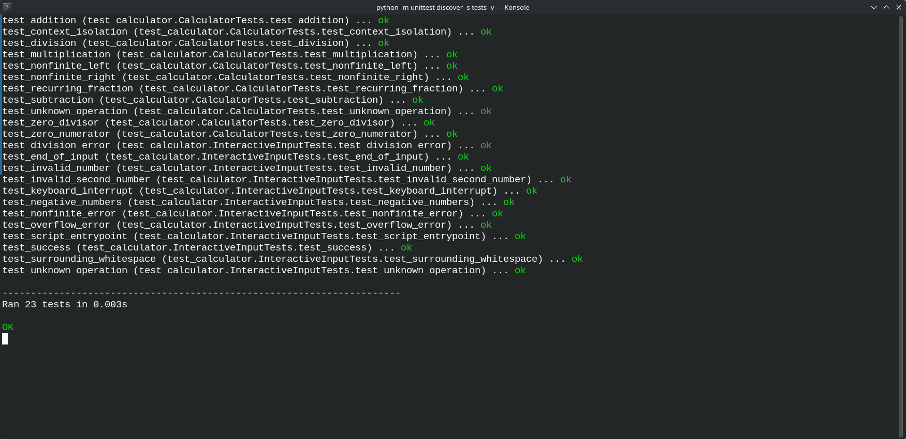
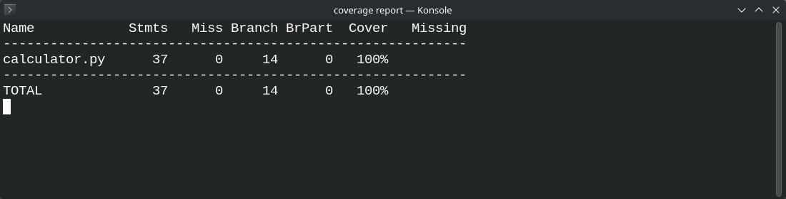
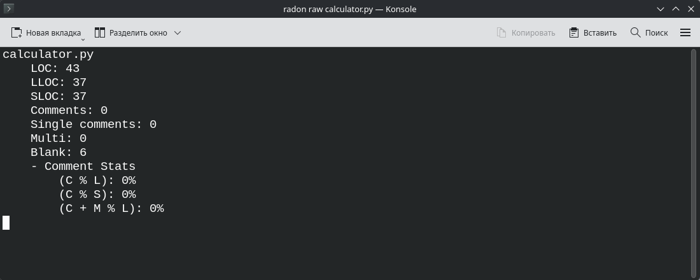
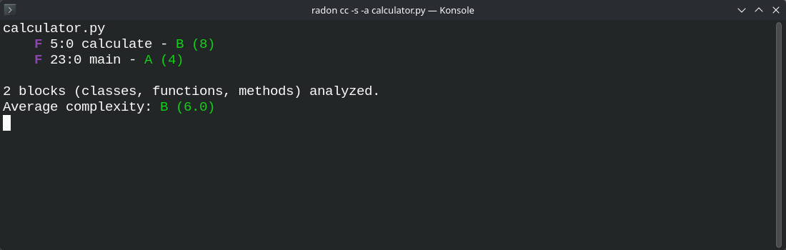

# Лабораторная работа №1

**«Критерии качества ПО: сложность, корректность, надёжность, трудоёмкость. Оценка качества ПО»**

**Выполнил:** Саввин Богдан, группа ПВ-231.

## 1. Цель работы

Научиться оценивать качество программы: писать unit-тесты, измерять покрытие кода, считать размер и цикломатическую сложность, находить и исправлять ошибки.

## 2. Теоретическая часть

### 2.1. Какие проблемы возникают при разработке сложных систем

**Сложность кода и связи между частями программы.** В большой системе изменение одного модуля может повлиять на другие. Из-за этого становится труднее искать ошибки и добавлять новые возможности. Чтобы с кодом было проще работать, его разделяют на небольшие модули с понятными задачами и интерфейсами. Проверка кода и расчёт сложности помогают найти функции, которые стоит упростить.

**Корректность и надёжность.** Программа должна правильно выполнять требования и работать в предусмотренных условиях. Проверки только на обычных данных для этого недостаточно. Например, калькулятор может верно складывать числа, но завершаться с ошибкой при делении на ноль. Поэтому нужны тесты для обычных, ошибочных и граничных значений. После исправления ошибки полезно добавить отдельный тест, который проверит этот случай при следующих изменениях.

**Трудоёмкость и сроки.** В начале разработки сложно точно оценить объём работы. Требования могут измениться, а найденные ошибки потребуют переделок. Работу удобнее делить на небольшие задачи и для каждой указывать, какой результат должен получиться. По мере выполнения оценки можно уточнять. Трудоёмкость измеряют в человеко-часах; одного количества строк кода для её оценки недостаточно.

### 2.2. Проблемы и возможные решения

| Проблема | Возможное решение | Инструменты и методы |
| --- | --- | --- |
| Код становится сложным, модули сильно зависят друг от друга | Разделять программу на модули, упрощать большие функции, проверять изменения | Модульная архитектура, проверка кода, рефакторинг, radon |
| Программа выдаёт неверные результаты или не обрабатывает ошибки | Проверять обычные и граничные случаи, обрабатывать исключения, добавлять тесты на найденные ошибки | unittest, coverage.py, модульное и интеграционное тестирование |
| Работа занимает больше времени, чем планировалось | Разбивать работу на задачи, расставлять приоритеты, сравнивать план с фактическими затратами | Аспро.Cloud, Kanban, учёт времени |

## 3. Практическая часть

### 3.1. Калькулятор на Python

Для работы я написал консольный калькулятор в файле `calculator.py`. Он складывает, вычитает, умножает и делит два числа. Функция `calculate(a, operation, b)` выполняет вычисление, а `main()` отвечает за ввод и вывод.

Числа и знак операции вводятся по очереди через `input()`. Для дробных чисел используется `Decimal` с точностью 28 значащих цифр. Например, сложение `0.1` и `0.2` даёт `0.3`, а бесконечные дроби округляются.

Пример запуска:

```text
$ python3 calculator.py
Введите первое число: 0.1
Введите операцию (+, -, *, /): +
Введите второе число: 0.2
Результат: 0.3
```

За один запуск выполняется одно вычисление. Дробные числа нужно вводить через точку, знак операции — без кавычек. Если ввести неверное число, неизвестную операцию или нулевой делитель, программа покажет сообщение об ошибке. Завершение ввода и Ctrl+C тоже обрабатываются.

При успешном вычислении код завершения равен 0, при ошибке — 2. Для самого калькулятора достаточно стандартной библиотеки Python.

Основные файлы проекта:

- `calculator.py` — вычисления и интерактивный ввод;
- `tests/test_calculator.py` — тесты;
- `requirements-dev.txt` — зависимости для проверки;
- `README.md` — отчёт;
- `screenshots/` — скриншоты.

### 3.2. Задачи в Аспро.Cloud

В проекте «ЛР1 — Качество ПО: Python-калькулятор» я разделил разработку на шесть задач. Для каждой указал ожидаемый результат и критерии приёмки.

[Проект в Аспро.Cloud](https://xttps.aspro.cloud/_module/st/view/project/24?tab=project_report_list).

| Задача | Ссылка |
| --- | --- |
| 01. Реализовать арифметические операции на Decimal | [Задача №193](https://xttps.aspro.cloud/_module/task/view/task/193) |
| 02. Добавить интерактивный ввод через input() | [Задача №194](https://xttps.aspro.cloud/_module/task/view/task/194) |
| 03. Написать unit-тесты для калькулятора | [Задача №195](https://xttps.aspro.cloud/_module/task/view/task/195) |
| 04. Обработать неверный ввод и деление на ноль | [Задача №196](https://xttps.aspro.cloud/_module/task/view/task/196) |
| 05. BUG-001: обработать переполнение Decimal | [Задача №197](https://xttps.aspro.cloud/_module/task/view/task/197) |
| 06. Документировать запуск и использование калькулятора | [Задача №198](https://xttps.aspro.cloud/_module/task/view/task/198) |

На скриншоте видны задачи проекта и отметки об их выполнении:



### 3.3. Unit-тесты

В `tests/test_calculator.py` я написал 23 теста с помощью `unittest`. Сначала проверил четыре операции, отрицательные и дробные числа. Затем добавил случаи, в которых программа могла ошибиться: деление на ноль, неизвестный знак, неверное число, NaN, Infinity и переполнение.

Отдельные тесты проверяют ввод через `input()`, пробелы вокруг значений, завершение потока ввода и Ctrl+C. В них сравниваются результат, сообщение об ошибке и код завершения. Запуск файла как программы также проверяется с чтением данных из текстового потока.

Повторяющиеся случаи с разными значениями объединены через `subTest`. Например, проверка деления на ноль выполняется для `0`, `-0` и `0.000`. Ещё один тест проверяет, что вычисление не меняет внешние настройки точности `Decimal`.

Команда запуска:

```bash
.venv/bin/python -m unittest discover -s tests -v
```

Все 23 теста прошли, ошибок при запуске не было.



### 3.4. Покрытие кода тестами

Чтобы проверить, какие части калькулятора выполнялись в тестах, я запустил их под coverage.py. Параметр `--branch` включает учёт ветвей: это позволяет увидеть, проверены ли оба исхода условий. Через `--source=calculator` в расчёт включён только `calculator.py`.

```bash
.venv/bin/python -m coverage run --branch --source=calculator -m unittest discover -s tests -v
.venv/bin/python -m coverage report --show-missing --fail-under=100
```

Тесты выполнили все 37 исполняемых строк и все 14 ветвей:

- покрытие строк: 37 / 37 × 100% = 100%;
- покрытие ветвей: 14 / 14 × 100% = 100%.

Результат coverage.py:



Такое покрытие показывает, что в тестах выполнен весь код калькулятора. При этом правильность результатов всё равно зависит от выбранных входных данных и самих проверок.

### 3.5. Размер программы

Для анализа размера и сложности я использовал тот же калькулятор. Тесты, зависимости и вспомогательные скрипты в расчёт не включал.

Размер файла проверил командой:

```bash
.venv/bin/python -m radon raw calculator.py
```

Получилось 43 физических строки (LOC), из них 37 строк кода (SLOC) и 6 пустых. Комментариев и строк документации в файле нет. Число логических строк LLOC тоже равно 37.

Вывод radon с подсчётом строк:



Для дальнейшего расчёта плотности дефектов использован размер 37 / 1000 = 0.037 KSLOC.

### 3.6. Цикломатическая сложность

Сложность функций я проверил командой:

```bash
.venv/bin/python -m radon cc -s -a calculator.py
```

У функции `calculate` сложность равна 8, ранг B. У `main` — 4, ранг A. Среднее значение для двух функций составило 6.0, ранг B.

Результат расчёта:



Для `calculate` я также сделал ручной расчёт. В функции есть следующие условия:

| Проверка | Вклад в число решений |
| --- | --- |
| `if not a.is_finite() or not b.is_finite()` | 2: условие `if` и дополнительный путь из-за `or` |
| Выбор операции: четыре проверки для `+`, `-`, `*`, `/` | 4 |
| Проверка `b == 0` перед делением | 1 |
| Всего | 7 |

К числу решений добавляется единица:

**V(G) = 7 + 1 = 8.**

Результат совпал с radon. Оператор `or` учитывается отдельно, потому что второе выражение проверяется только при необходимости. Блок `with localcontext()` новых ветвлений не добавляет.

Через граф потока управления тот же показатель рассчитывается по формуле V(G) = E − N + 2P, где E — число рёбер, N — число узлов, P — число компонент связности. Для одной функции P = 1.

По шкале radon ранг B означает умеренную сложность. Основная часть ветвлений в калькуляторе связана с выбором операции и проверками ошибок.

### 3.7. Найденная ошибка и дефектность

При проверке больших чисел обнаружилась ошибка **BUG-001 — необработанное переполнение Decimal**.

**Как проверить этот случай в текущей версии:**

1. Запустить `python3 calculator.py`.
2. Ввести первое число `1e999999`, операцию `*` и второе число `10`.
3. Посмотреть сообщение программы и код завершения.

**Ожидалось:** сообщение об ошибке и код завершения 2.

**До исправления:** программа выводила трассировку исключения `decimal.Overflow`. Обработчик перехватывал только `InvalidOperation`, поэтому переполнение оставалось необработанным.

**После исправления:** обработчик перехватывает `DecimalException`, к которому относятся оба вида ошибок. Программа выводит сообщение «Ошибка: некорректное число или переполнение» и завершается с кодом 2.

Для этого случая я добавил `test_overflow_error`. При первой проверке один из 20 тестов завершался с ошибкой. После исправления и перехода на интерактивный ввод проходят все 23 теста.

За время работы найдена одна ошибка, она исправлена. Известных открытых дефектов не осталось. Плотность найденных дефектов в пересчёте на размер текущей версии:

**1 / 0.037 = 27.03 дефекта на тысячу строк кода.**

Значение получилось большим из-за малого размера программы: даже одна ошибка на 37 строк заметно влияет на показатель.

Время реакции на обращение оценить не удалось, поскольку обращений по проекту не было. От обнаружения ошибки до успешной проверки исправления прошло 9 секунд — с 16:04:30 до 16:04:39 по московскому времени. Это время устранения дефекта.

### 3.8. Как повторить проверку

Для измерений использованы Python 3.14.8, coverage.py 7.17.1 и radon 6.0.1. Зависимости и проверки запускаются следующими командами:

```bash
python3 -m venv .venv
.venv/bin/python -m pip install -r requirements-dev.txt
.venv/bin/python -m coverage run --branch --source=calculator -m unittest discover -s tests -v
.venv/bin/python -m coverage report --show-missing --fail-under=100
.venv/bin/python -m radon raw calculator.py
.venv/bin/python -m radon cc -s -a calculator.py
```

Результаты тестов, покрытие кода, размер программы и сложность функций выводятся в терминал.

## 4. Вывод

В этой работе я написал калькулятор на Python и оформил задачи по его разработке в Аспро.Cloud. Все 23 теста прошли, покрытие строк и ветвей составило 100%. Ручной расчёт сложности функции `calculate` совпал с результатом radon. Найденную ошибку обработки переполнения удалось исправить и проверить отдельным тестом.

Во время работы я научился писать unit-тесты, проверять ошибочные и граничные значения, измерять покрытие с помощью coverage.py и рассчитывать метрики в radon. Стало понятнее, как ветвления влияют на сложность функции и зачем после исправления ошибки добавлять регрессионный тест. Также научился сопоставлять размер, сложность и результаты тестирования при оценке качества программы.

## 5. Итоговая таблица метрик проекта

| Метрика | Результат | Способ измерения |
| --- | --- | --- |
| Размер, LOC / SLOC / LLOC | 43 / 37 / 37 | `radon raw` |
| Сложность `calculate` | 8, ранг B | `radon cc`; ручной расчёт 7 + 1 |
| Сложность `main` | 4, ранг A | `radon cc` |
| Средняя сложность функций | 6.0, ранг B | `radon cc -a` |
| Дефекты: найдено / исправлено / открыто | 1 / 1 / 0 | BUG-001 и регрессионный тест |
| Плотность найденных дефектов | 27.03 / KSLOC | 1 / (37 / 1000) |
| Время реакции | Не измерялось | Обращений по проекту не было |
| Время устранения дефекта | 9 с | От обнаружения до успешной проверки исправления |
| Покрытие строк | 100%, 37/37 | coverage.py |
| Покрытие ветвей | 100%, 14/14 | coverage.py с учётом ветвей |
| Unit-тесты | 23 успешных, 0 ошибок | `unittest` |
