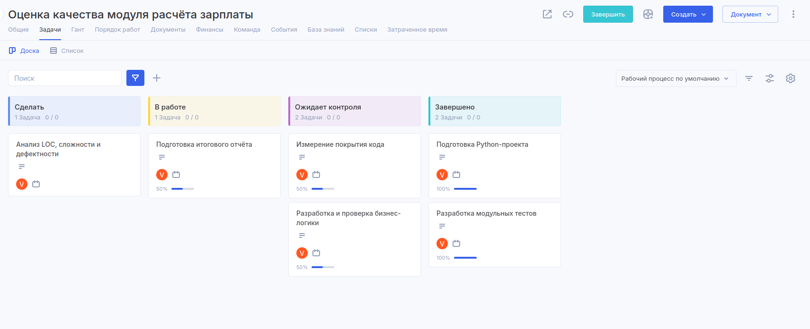
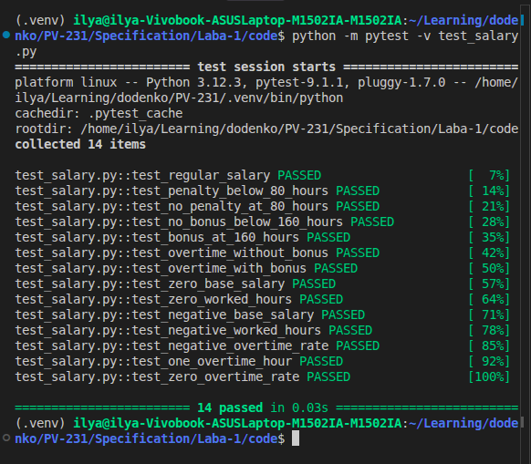
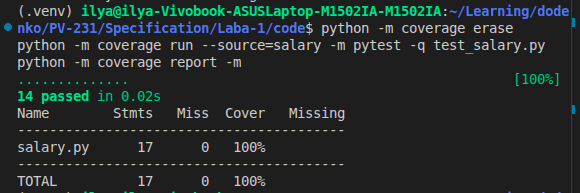
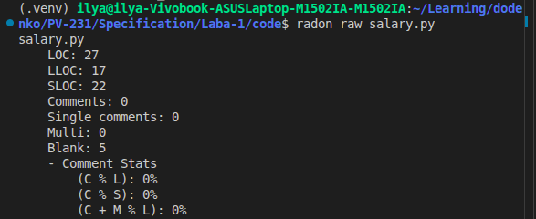

# Спецификация ПО. Рыбаков Илья ПВ-231

# Лабораторная работа №1.

**Тема:** Критерии качества ПО: сложность, корректность, надёжность, трудоёмкость. Оценка качества ПО.

**Цель:** Освоить практические методы оценки качества и метрик программного обеспечения.

# Теоретическая часть

## Наиболее значимые проблемы разработки сложных программных систем

1. **Рост сложности программного обеспечения.** По мере развития системы увеличивается число компонентов, зависимостей и возможных сценариев выполнения. Это усложняет понимание кода, поиск дефектов и внесение изменений без нарушения уже существующей функциональности.
2. **Обеспечение корректности и надёжности.** Программа должна не только правильно выполнять основные операции, но и корректно обрабатывать граничные значения и ошибочные входные данные. Отсутствие регулярного тестирования повышает риск регрессий.
3. **Оценка трудоёмкости и управление разработкой.** Сложно заранее определить стоимость и продолжительность работ. Изменение требований и отсутствие прозрачного распределения задач могут привести к задержкам и увеличению затрат.

## Возможные решения

| Проблема | Возможное решение | Инструменты / методы |
|---|---|---|
| Рост сложности системы | Упрощение функций, модульная структура, регулярный анализ кода | Рефакторинг, code review, `radon`, метрики LOC и цикломатической сложности |
| Недостаточная корректность и надёжность | Проверка типовых, граничных и ошибочных сценариев, автоматический запуск проверок | Unit-тестирование, `pytest`, `coverage.py`, обработка исключений |
| Неопределённость трудоёмкости | Декомпозиция работы, назначение ответственных, контроль статусов и фактического времени | Аспро.Cloud, планирование, оценка трудозатрат, тайм-трекер |

# Практическая часть

## Тестовый проект: расчёт заработной платы сотрудника

В качестве небольшого программного проекта использован модуль расчёта заработной платы с бонусами, подготовленный ранее для дисциплины «Тестирование ПО». В данной работе код выделен в отдельный модуль, дополнен тестами граничных случаев и исследован с помощью количественных метрик качества.

Проект состоит из следующих файлов:

| Файл | Назначение |
|---|---|
| `salary.py` | Основная логика расчёта заработной платы |
| `main.py` | Пример отдельного запуска программы |
| `test_salary.py` | Модульные тесты |
| `requirements.txt` | Библиотеки для тестирования и анализа метрик |

## Код модуля

```python
def calculate_salary(
    base_salary: float,
    worked_hours: int,
    overtime_rate: float,
    has_bonus: bool
) -> float:
    if base_salary < 0:
        raise ValueError("base_salary must be >= 0")
    if worked_hours < 0:
        raise ValueError("worked_hours must be >= 0")
    if overtime_rate < 0:
        raise ValueError("overtime_rate must be >= 0")

    salary = float(base_salary)

    if worked_hours < 80:
        salary *= 0.8

    if worked_hours > 160:
        hourly_rate = base_salary / 160
        overtime_hours = worked_hours - 160
        salary += overtime_hours * hourly_rate * overtime_rate

    if has_bonus and worked_hours >= 160:
        salary *= 1.2

    return max(0.0, salary)
```

## Бизнес-правила

- При отрицательном окладе, количестве отработанных часов или коэффициенте сверхурочной оплаты генерируется `ValueError`.
- Если сотрудник отработал менее 80 часов, оклад уменьшается на 20%.
- При 80–160 отработанных часах выплачивается полный базовый оклад.
- Каждый час сверх 160 оплачивается дополнительно по ставке `base_salary / 160 * overtime_rate`.
- Если установлен признак `has_bonus=True` и отработано не менее 160 часов, итог увеличивается на 20%.
- Возвращаемое значение не может быть отрицательным.

**Входные параметры:** `base_salary` — оклад (`float`); `worked_hours` — часы (`int`); `overtime_rate` — коэффициент (`float`); `has_bonus` — признак премии (`bool`).

**Выходной параметр:** рассчитанная заработная плата (`float`).

Наиболее важные граничные значения: `worked_hours = 79`, `80`, `159`, `160`, `161`, а также нулевые значения оклада и коэффициента сверхурочных.

Пример запуска `python main.py`:

```text
Итоговая зарплата: 210000.00
```

## Управление проектом в Аспро.Cloud

Для организации работы выбрана система Аспро.Cloud. Планируемое название проекта: **«Оценка качества модуля расчёта зарплаты»**. Проект позволяет распределить этапы работы по задачам и отследить их завершение.

| № | Задача | Критерий выполнения |
|---|---|---|
| 1 | Подготовка Python-проекта | Созданы `salary.py`, `main.py`, установлены зависимости |
| 2 | Разработка и проверка бизнес-логики | Выполнен пример расчёта, проверены условия начисления |
| 3 | Разработка модульных тестов | Созданы и успешно выполнены 14 тестов |
| 4 | Измерение покрытия кода | Получен отчёт `coverage.py` по `salary.py` |
| 5 | Анализ LOC, сложности и дефектности | Рассчитаны показатели размера, сложности и обнаруженных дефектов |
| 6 | Подготовка итогового отчёта | Все полученные показатели сведены в таблицу |

В проекте необходимо назначить себя ответственным, создать перечисленные задачи и перевести их в завершённый статус после выполнения. Точный статус и результат работы в Аспро.Cloud подтверждаются собственным скриншотом:



## Модульное тестирование

Для проверки использована библиотека `pytest`. Тесты покрывают основные бизнес-правила, граничные значения и ошибочные входные данные.

| ID | Тип проверки | Входные данные (`base_salary`, `worked_hours`, `overtime_rate`, `has_bonus`) | Ожидаемый результат |
|---|---|---|---|
| TC-01 | Позитивная | `160000, 160, 1.5, False` | `160000` |
| TC-02 | Граничная | `160000, 79, 1.5, False` | `128000` |
| TC-03 | Граничная | `160000, 80, 1.5, False` | `160000` |
| TC-04 | Граничная | `160000, 159, 1.5, True` | `160000` |
| TC-05 | Граничная | `160000, 160, 1.5, True` | `192000` |
| TC-06 | Позитивная | `160000, 170, 1.5, False` | `175000` |
| TC-07 | Позитивная | `160000, 170, 1.5, True` | `210000` |
| TC-08 | Граничная | `0, 170, 1.5, True` | `0` |
| TC-09 | Граничная | `160000, 0, 1.5, False` | `128000` |
| TC-10 | Негативная | `-1, 160, 1.5, False` | `ValueError` |
| TC-11 | Негативная | `160000, -1, 1.5, False` | `ValueError` |
| TC-12 | Негативная | `160000, 170, -1, False` | `ValueError` |
| TC-13 | Граничная | `160000, 161, 1.5, False` | `161500` |
| TC-14 | Граничная | `160000, 170, 0, False` | `160000` |

### Реализованные автотесты

```python
import pytest
from salary import calculate_salary


def test_regular_salary():
    assert calculate_salary(160000, 160, 1.5, False) == pytest.approx(160000)


def test_penalty_below_80_hours():
    assert calculate_salary(160000, 79, 1.5, False) == pytest.approx(128000)


def test_no_penalty_at_80_hours():
    assert calculate_salary(160000, 80, 1.5, False) == pytest.approx(160000)


def test_no_bonus_below_160_hours():
    assert calculate_salary(160000, 159, 1.5, True) == pytest.approx(160000)


def test_bonus_at_160_hours():
    assert calculate_salary(160000, 160, 1.5, True) == pytest.approx(192000)


def test_overtime_without_bonus():
    assert calculate_salary(160000, 170, 1.5, False) == pytest.approx(175000)


def test_overtime_with_bonus():
    assert calculate_salary(160000, 170, 1.5, True) == pytest.approx(210000)


def test_zero_base_salary():
    assert calculate_salary(0, 170, 1.5, True) == pytest.approx(0)


def test_zero_worked_hours():
    assert calculate_salary(160000, 0, 1.5, False) == pytest.approx(128000)


def test_negative_base_salary():
    with pytest.raises(ValueError):
        calculate_salary(-1, 160, 1.5, False)


def test_negative_worked_hours():
    with pytest.raises(ValueError):
        calculate_salary(160000, -1, 1.5, False)


def test_negative_overtime_rate():
    with pytest.raises(ValueError):
        calculate_salary(160000, 170, -1, False)


def test_one_overtime_hour():
    assert calculate_salary(160000, 161, 1.5, False) == pytest.approx(161500)


def test_zero_overtime_rate():
    assert calculate_salary(160000, 170, 0, False) == pytest.approx(160000)
```

### Результаты тестирования

В подготовленном проекте выполнена команда `python -m pytest -v test_salary.py`. Результат проверки:

```text
collected 14 items
14 passed
```

Все 14 тестов завершились успешно. Обнаруженных отказов в предусмотренных сценариях не было.



## Покрытие кода тестами

Для анализа покрытия выполнены команды:

```bash
python -m coverage run --source=salary -m pytest -q test_salary.py
python -m coverage report -m
```

Полученный результат:

```text
Name        Stmts   Miss  Cover   Missing
-----------------------------------------
salary.py      17      0   100%
-----------------------------------------
TOTAL          17      0   100%
```

В исследуемом модуле зафиксировано 17 исполняемых операторов. Все они были выполнены тестами, покрытие операторов составляет **100%**. Это характеризует полноту выполнения строк кода, но само по себе не доказывает отсутствие всех возможных ошибок.



## Размер программного обеспечения (LOC)

Для измерения размера исследован исходный файл `salary.py` без тестов и файла демонстрационного запуска. Это позволяет оценить непосредственно рабочую логику, не смешивая её с тестовой инфраструктурой.

| Показатель | Значение |
|---|---:|
| LOC — физические строки файла | 27 |
| SLOC — непустые строки с кодом | 22 |
| LLOC — логические инструкции | 17 |
| Пустые строки | 5 |
| Строки комментариев | 0 |

Значения LOC и SLOC получены подсчётом строк файла; LLOC рассчитано по логическим инструкциям. Для независимой проверки в установленном окружении предусмотрена команда `radon raw salary.py`.



## Цикломатическая сложность

Цикломатическая сложность характеризует число независимых путей исполнения функции. Для функции `calculate_salary()` значение рассчитано по упрощённой формуле:

\[
V(G) = D + 1
\]

Здесь `D` — число точек принятия решения. В функции содержится шесть операторов `if`. Логическое `and` в условии премирования дополнительно увеличивает сложность на единицу при подсчёте по правилам Radon. Следовательно:

\[
V(G) = 6 + 1 + 1 = 8
\]

| Функция | Цикломатическая сложность | Категория Radon |
|---|---:|---|
| `calculate_salary` | 8 | B |

Значение 8 указывает на умеренную сложность функции: основные бизнес-правила расположены в одном месте, но количество проверяемых путей уже достаточно велико, чтобы требовать систематических тестов. Для инструментального подтверждения необходимо выполнить `radon cc -s salary.py`.


## Дефектность и время реакции

По результатам 14 реализованных тестов зарегистрировано **0 обнаруженных дефектов**. Плотность обнаруженных дефектов для исследуемого файла:

\[
D_{KLOC} = \frac{0}{22 / 1000} = 0
\]

Таким образом, в рамках данной ограниченной проверки плотность обнаруженных дефектов составила **0 дефектов на 1000 непустых строк кода**. Это не означает, что программа гарантированно не содержит дефектов за пределами проверенных случаев.

Время реакции на дефекты не измерялось, поскольку в ходе проверки не было зарегистрировано ни одного дефектного инцидента. В Аспро.Cloud этот показатель можно измерить при наличии реального замечания как интервал между временем его регистрации и первым началом работы по исправлению.

## Итоговая таблица метрик качества

| Метрика | Полученный результат |
|---|---|
| Размер ПО, LOC | 27 физических строк в `salary.py` |
| Размер ПО, SLOC | 22 непустые строки |
| Логические инструкции, LLOC | 17 |
| Цикломатическая сложность | 8, класс B (ручной расчёт) |
| Автоматизированные тесты | 14 успешно, 0 неуспешных |
| Покрытие кода операторами | 100% (17 из 17) |
| Обнаруженные дефекты | 0 по результатам проведённых тестов |
| Плотность обнаруженных дефектов | 0 на KSLOC для проверенного объёма |
| Время реакции на дефект | Не измерялось — дефекты не зарегистрированы |
| Трудоёмкость | Учёт и сравнение плановых/фактических затрат времени доступны в Аспро.Cloud; фактическое значение не фиксировалось |

# Вывод

В ходе лабораторной работы были рассмотрены основные проблемы разработки сложных программных систем и способы их решения. Для практической оценки качества использован программный модуль расчёта заработной платы сотрудника, для которого подготовлено и успешно выполнено 14 модульных тестов.

Покрытие операторов составило 100%, размер исследуемого файла — 27 физических строк, а цикломатическая сложность основной функции — 8. В ходе проведённых проверок дефекты выявлены не были. Полученные показатели позволяют оценить размер и структурную сложность модуля, полноту выполненных тестов и результаты ограниченной проверки корректности. Использование системы Аспро.Cloud дополнительно позволяет организовать контроль задач и, при наличии реальных записей времени, оценивать трудоёмкость разработки.
