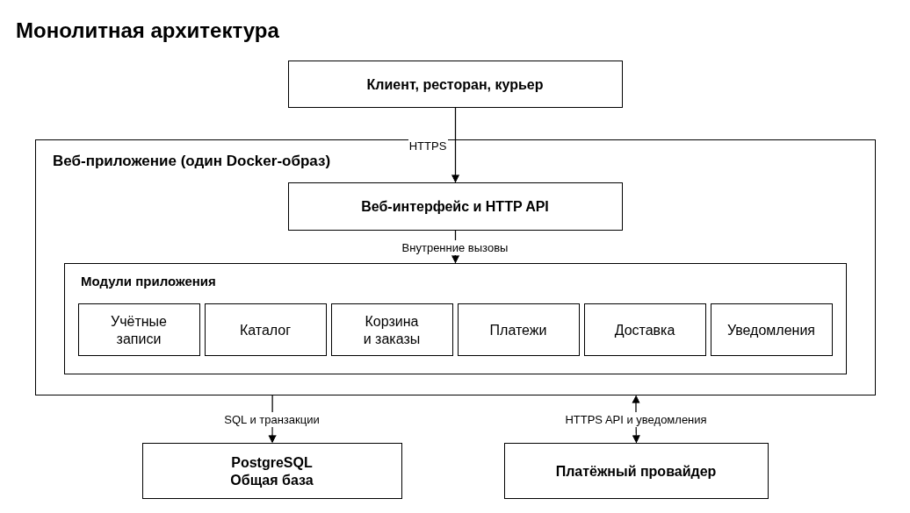
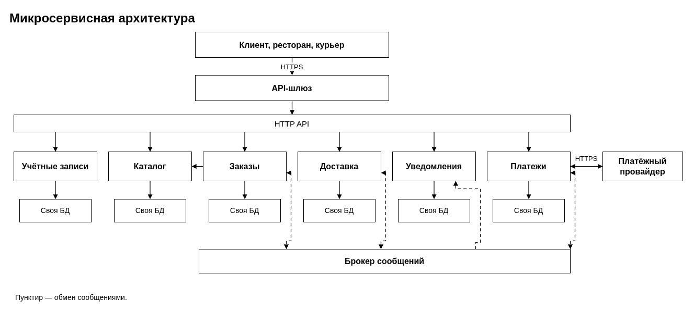
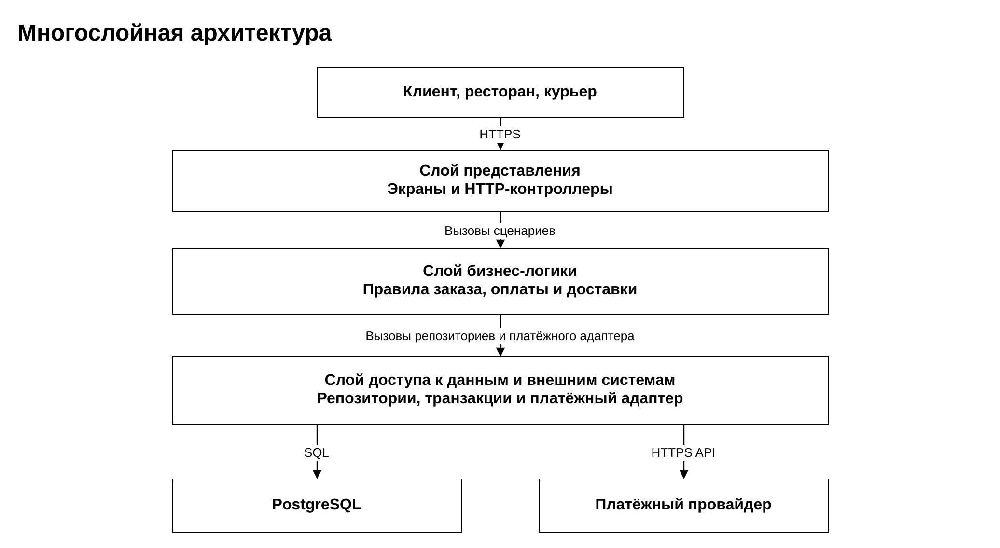
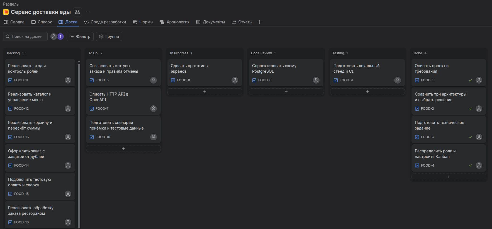

# Лабораторная работа №2

**«Анализ требований, выбор архитектуры программного обеспечения и организация командной разработки»**

**Проект:** «Сервис доставки еды»

**Выполнил:** Саввин Богдан, группа ПВ-231.

---

## 1. Цель работы

Получить практические навыки анализа требований к программному обеспечению, проектирования архитектуры информационной системы, формирования команды разработки и распределения задач между участниками проекта.

## 2. Описание проекта

«Сервис доставки еды» — веб-приложение, через которое клиент выбирает блюда в ресторане, оформляет и оплачивает заказ, а затем следит за доставкой. Сотрудник ресторана управляет меню и обработкой заказов, курьер принимает доступную доставку и отмечает её этапы.

| Кто использует сервис | Какую проблему решает сервис |
| --- | --- |
| Клиент | Видит актуальное меню и итоговую стоимость, проверяет доступность доставки по адресу и узнаёт, на каком этапе заказ. |
| Сотрудник ресторана | Получает оплаченные заказы с составом и комментариями, меняет доступность блюд и сообщает о готовности заказа. |
| Курьер | Видит доступные доставки, резервирует одну из них и получает адрес, необходимый для выполнения заказа. |

Первая версия рассчитана на один город и доставку из одного ресторана в рамках заказа. Клиенты и курьеры пользуются мобильным браузером, сотрудники ресторанов могут работать с компьютера. Приложение работает на сервере Linux и обращается к внешнему платёжному провайдеру. Для демонстрации используются тестовые учётные записи, адреса и платежи в песочнице.

## 3. Требования к системе

### 3.1. Функциональные требования

| Идентификатор | Название | Пользователь | Описание | Ожидаемый результат |
| --- | --- | --- | --- | --- |
| FR-01 | Регистрация и вход | Клиент, сотрудник ресторана, курьер | Клиент регистрируется по электронной почте и паролю. Сотрудник и курьер входят в заранее созданные учётные записи. | После входа пользователь получает доступ к операциям своей роли. |
| FR-02 | Просмотр каталога | Клиент | Клиент выбирает адрес и открывает меню доступного ресторана. | Видны рестораны, доставляющие по адресу, и доступные блюда с актуальными ценами. |
| FR-03 | Управление меню | Сотрудник ресторана | Сотрудник добавляет блюда своего ресторана и изменяет их цену и доступность. | Изменения видны в каталоге при следующем запросе. |
| FR-04 | Работа с корзиной | Клиент | Клиент добавляет блюда одного ресторана, меняет количество и удаляет позиции. | Корзина показывает выбранные позиции и предварительную стоимость блюд. |
| FR-05 | Оформление заказа | Клиент | Клиент вводит адрес и комментарий. Сервер проверяет зону доставки, наличие блюд и цену, добавляет стоимость доставки и просит повторное подтверждение, если сумма изменилась. | После подтверждения сохраняется один заказ с номером, адресом, составом и итоговой суммой. Статус заказа — «Ожидает оплаты». |
| FR-06 | Оплата заказа | Клиент | Клиент переходит на страницу платёжного провайдера. Сервер проверяет подпись уведомления, сумму и связь платежа с заказом. | Успешная оплата переводит заказ в статус «Оплачен». После явного отказа можно повторить оплату. При неопределённом результате сервис сначала сверяет состояние платежа. |
| FR-07 | Обработка заказа рестораном | Сотрудник ресторана | Сотрудник принимает или отклоняет оплаченный заказ своего ресторана. Принятый заказ отмечает готовым после приготовления. | Заказ переходит в статусы «Готовится» и «Готов к выдаче» либо «Отменён» с началом возврата. |
| FR-08 | Доставка заказа | Курьер | Курьер принимает доступный готовый заказ и отмечает его получение и вручение. | За заказом закрепляется один курьер. Только он может перевести заказ в статусы «В пути» и «Доставлен». |
| FR-09 | Уведомления о смене статуса | Клиент, сотрудник ресторана, курьер | Сервис показывает уведомления в кабинете при изменении статуса заказа. Открытый кабинет опрашивает сервер каждые 10 секунд. | Уведомление содержит номер заказа и новый статус и появляется в открытом кабинете в течение 15 секунд при штатной работе. |
| FR-10 | Просмотр заказов | Клиент, сотрудник ресторана, курьер | Клиент открывает свои заказы. Сотрудник ресторана видит заказы своего ресторана, курьер — доступные доставки в своей зоне и назначенные ему доставки. | Отображается актуальный статус. Точный адрес клиента доступен курьеру после назначения. |
| FR-11 | Отмена заказа и возврат | Клиент, сотрудник ресторана | Клиент отменяет заказ до принятия рестораном. Ресторан может отклонить оплаченный заказ до принятия. Если оплата подтверждена, сервис запрашивает возврат и сверяет результат у провайдера. | Заказ получает статус «Отменён». Для списанной суммы выполняется один возврат. Клиент видит состояние возврата в заказе. |

Основной маршрут заказа — «Ожидает оплаты» → «Оплачен» → «Готовится» → «Готов к выдаче» → «В пути» → «Доставлен». Назначение курьера сохраняется до выдачи заказа. Состояние платежа и возврата хранится отдельно от статуса заказа. Если платёж подтвердится после отмены, заказ остаётся отменённым и сервис запускает возврат.

### 3.2. Нефункциональные требования

| Идентификатор | Категория | Требование |
| --- | --- | --- |
| NFR-01 | Надёжность | Повтор отправки заказа с тем же ключом и повтор платёжного уведомления сохраняют один результат операции. После сбоя приложение сверяет незавершённые платежи и возвраты с провайдером. Резервная копия БД создаётся ежедневно. Для учебного стенда допустимая потеря данных при восстановлении из копии составляет не более 24 часов, восстановление занимает не более 60 минут. |
| NFR-02 | Производительность | При 100 одновременно работающих клиентах 95-й процентиль времени ответа API каталога и просмотра заказа не превышает 1 секунды, оформления заказа — 2 секунд. Из замера оформления исключается переход на страницу провайдера. Параметры стенда и длительность прогона фиксируются в протоколе. |
| NFR-03 | Безопасность | Доступ к стенду осуществляется по HTTPS. Пароли хранятся в виде хешей Argon2id. API проверяет роль и право на конкретный объект. Платёжные реквизиты вводятся на странице провайдера. Приложение хранит идентификатор операции, сумму и статус, проверяет подпись уведомлений и исключает пароли, секреты и адреса клиентов из журналов. |
| NFR-04 | Масштабируемость | Серверное приложение запускается в двух экземплярах за обратным прокси. Состояние заказов и сеансов хранится в общей БД. Запросы одного пользователя могут обслуживаться обоими экземплярами, а фоновые задания распределяются через блокировки записей в БД. |
| NFR-05 | Условия эксплуатации | Клиентская часть поддерживает актуальные версии Chrome и Firefox на ПК и Android. Учебный стенд работает на Linux с Docker Compose и PostgreSQL. Для проверки оплаты используется песочница провайдера. |

## 4. Проектирование архитектуры

### 4.1. Монолитная архитектура

Веб-интерфейс и HTTP API поставляются в составе одного приложения. Внутри него выделены модули учётных записей, каталога, корзины и заказов, платежей, доставки и уведомлений. При оформлении заказа контроллер вызывает модуль заказов, который проверяет корзину и записывает заказ и его позиции в PostgreSQL в одной транзакции. Модули обращаются друг к другу через внутренние интерфейсы. Для оплаты и возврата платёжный модуль обращается к провайдеру по HTTPS, принимает подписанные уведомления и сверяет результаты при сбоях.

Приложение собирается в один Docker-образ. PostgreSQL работает отдельно и хранит пользователей, меню, корзины, заказы, платежи и доставки. При обновлении изменяется один образ приложения. Для масштабирования за прокси запускаются дополнительные экземпляры того же образа.

**Преимущества.** Меньше компонентов для развёртывания и отладки. Заказ, его позиции и запись о дальнейшей обработке можно сохранить одной транзакцией.

**Недостатки.** Для выпуска изменения в одном модуле приходится пересобирать всё приложение. Для роста нагрузки на каталог масштабируется весь сервер. Сбой единственного экземпляра на учебном стенде прерывает обработку запросов до перезапуска.

### 4.2. Микросервисная архитектура

Браузеры работают через API-шлюз. Сервисы развёртываются независимо и владеют своими данными. Каждый сервис использует отдельную логическую БД PostgreSQL со своими правами доступа. Для запросов, результат которых нужен сразу, используется HTTP API. Смены статусов передаются через брокер сообщений.

| Компонент | Назначение и функции | Данные | Взаимодействие |
| --- | --- | --- | --- |
| API-шлюз | Принимает HTTPS-запросы и направляет их в нужный сервис. | Конфигурация маршрутов. | Проверяет токен и вызывает HTTP API. Сервисы проверяют доступ к конкретным объектам. |
| Сервис учётных записей | Регистрирует клиента, выполняет вход и выдаёт токены. | Учётные записи, хеши паролей, роли. | Получает запросы через шлюз и публикует открытый ключ для проверки токенов. |
| Сервис каталога | Возвращает список ресторанов и меню, принимает изменения от ресторана. | Рестораны, зоны доставки, меню и цены. | Отвечает на HTTP-запросы шлюза и сервиса заказов. |
| Сервис заказов | Ведёт корзину, оформляет заказ, хранит его статус и обрабатывает действия ресторана. | Корзины, адреса, состав и стоимость заказов, история статусов. | Проверяет меню через HTTP API каталога. Через брокер передаёт команды платежам и готовые заказы доставке, принимает события об оплате и доставке, публикует смену статуса. |
| Сервис платежей | Создаёт платёжные сессии, принимает уведомления провайдера, выполняет сверку и возврат. | Идентификаторы платежей и возвратов, суммы и статусы операций. | Обращается к провайдеру по HTTPS. Принимает команды заказов и публикует результаты через брокер. |
| Сервис доставки | Показывает доступные доставки, назначает курьера и фиксирует вручение. | Задания на доставку, назначение курьера и этапы доставки. | Получает готовые заказы и отправляет события о ходе доставки через брокер. Предоставляет курьеру HTTP API. |
| Сервис уведомлений | Формирует уведомления для кабинетов пользователей. | Уведомления и отметки о прочтении. | Получает события о смене статуса заказа через брокер и выдаёт уведомления через HTTP API. |

Например, при оплате сервис платежей сохраняет результат и событие в одной локальной транзакции. Фоновый обработчик отправляет событие в брокер, а сервис заказов применяет его по идентификатору события один раз. После обработки обновлённый статус появляется в заказе. Если заказ уже отменён, сервис заказов отправляет команду возврата.

Такой вариант позволяет независимо выпускать и масштабировать каталог, платежи и другие части системы. Для обработки одного заказа при этом приходится учитывать задержки сети, повторную доставку событий и временное расхождение статусов. Развёртывание требует брокера, контроля нескольких БД и сквозного наблюдения за запросами.

### 4.3. Многослойная архитектура

| Слой | Назначение и компоненты | Взаимодействие |
| --- | --- | --- |
| Представление | Экраны клиента, ресторана и курьера, HTTP-контроллеры и преобразование запросов и ответов. | Принимает HTTPS-запросы и вызывает операции слоя бизнес-логики. |
| Бизнес-логика | Сценарии входа, каталога, корзины, оформления, оплаты, доставки и уведомлений. Здесь проверяются права, итоговая сумма и допустимость смены статуса. | Использует интерфейсы репозиториев и платёжного шлюза. Определяет, какие изменения должны сохраняться в одной транзакции. |
| Доступ к данным и внешним системам | Реализации репозиториев PostgreSQL, управление транзакциями и адаптер провайдера оплаты. | Выполняет запросы к PostgreSQL и обращения к внешнему API по HTTPS. Возвращает результат бизнес-логике. |

Например, при изменении статуса доставки контроллер передаёт данные запроса бизнес-слою. Тот проверяет, назначен ли курьер на заказ, и разрешён ли переход. Репозиторий сохраняет новый статус и запись для уведомления. Контроллер возвращает результат в кабинет курьера.

### 4.4. Выбор архитектуры

Для первой версии я выбрал модульный монолит с тремя логическими слоями. Монолит определяет способ сборки и развёртывания, а слои — распределение обязанностей в коде. В таком варианте небольшая команда может проверять работу заказа, оплаты и доставки на одном стенде. Границы модулей позволяют менять экран, бизнес-правило или способ хранения с ограниченным числом изменений. Микросервисный вариант имеет смысл рассматривать после появления нагрузки, которая требует раздельного масштабирования отдельных модулей.

## 5. Техническое задание

### 5.1. Введение

Полное наименование системы — «Сервис доставки еды». Это автоматизированная система оформления и сопровождения заказов готовых блюд. В неё входят веб-кабинеты клиента, ресторана и курьера, серверное приложение, база данных и интеграция с тестовым платёжным провайдером.

### 5.2. Основания для разработки

Основание разработки — учебное задание на лабораторную работу №2 по дисциплине «Спецификация, архитектура и проектирование программных систем». Условный заказчик — оператор городской службы доставки. Для учебного проекта принято, что заказчику нужны единый учёт заказов, актуальное меню, онлайн-оплата и возможность узнать статус доставки.

### 5.3. Назначение и цели создания системы

Система предназначена для координации клиента, ресторана и курьера от выбора блюда до вручения заказа. Цель первой версии — обеспечить прохождение заказа по основному маршруту через три кабинета и обработать отказ оплаты, отмену и возврат. Достижение целей оценивается по сценариям раздела 5.6.

Объект автоматизации — процесс доставки готовых блюд из ресторанов-партнёров в пределах одного города. Клиент указывает адрес из зоны доставки, ресторан готовит заказ, курьер вручает его клиенту. При демонстрации используются заранее подготовленные меню, зоны и учётные записи сотрудников и курьеров.

### 5.4. Требования к системе

Система должна обеспечивать регистрацию и вход, просмотр каталога, управление меню, работу с корзиной, оформление и оплату, обработку заказа в ресторане, доставку, уведомления, просмотр заказов и отмену с возвратом. Действия пользователей и ожидаемые результаты определены требованиями FR-01–FR-11 в разделе 3.1.

Надёжность определяется NFR-01, время ответа — NFR-02, защита данных и разграничение доступа — NFR-03, масштабирование — NFR-04, условия эксплуатации — NFR-05. Для разработки принята архитектура из раздела 4.4. Приложение поставляется в виде Docker-образа, а структура БД разворачивается миграциями.

### 5.5. Состав и содержание работ

| Этап | Основные работы | Ожидаемый результат |
| --- | --- | --- |
| 1. Анализ и проектирование | Описать роли и сценарии, сформулировать требования, сравнить архитектуры, подготовить ТЗ и план разработки. | Требования, архитектурные схемы, ТЗ и доска Jira. |
| 2. Подготовка разработки | Описать HTTP API и переходы заказа, спроектировать БД, подготовить прототипы экранов, окружение и сценарии приёмки. | OpenAPI, миграции, прототипы, стенд разработки и тестовые данные. |
| 3. Реализация | Разработать кабинеты, бизнес-логику и работу с данными, подключить песочницу оплаты. | Сборка, на которой можно провести заказ и обработать отказ или отмену. |
| 4. Проверка и подготовка к вводу | Развернуть стенд, загрузить учебные данные, проверить резервное копирование, провести функциональные, нагрузочные проверки и проверку доступа. | Стенд, протокол проверок и инструкция запуска. |
| 5. Приёмка | Продемонстрировать основной и альтернативные сценарии, передать документацию и зафиксировать результаты. | Протокол приёмки со списком проверок и замечаний. |

### 5.6. Порядок контроля и приёмки

Разработчики проверяют бизнес-правила модульными тестами. Тестировщик проводит интеграционные проверки API, БД и песочницы оплаты, а также выполняет сквозные сценарии в браузере. Для демонстрации руководитель проекта подготавливает стенд с одним рестораном, двумя клиентскими учётными записями и двумя курьерами.

| Что проверяется | Критерий приёмки |
| --- | --- |
| Вход, каталог и корзина (FR-01–FR-04) | Клиент регистрируется и входит, видит рестораны по адресу и меняет корзину. Изменение цены и доступности блюда сотрудником видно при следующем запросе каталога. |
| Основной маршрут заказа (FR-05–FR-10) | Клиент подтверждает итоговую сумму и платит в песочнице. Ресторан принимает заказ и отмечает готовность. Один курьер принимает доставку, получает и вручает заказ. Клиент видит статус «Доставлен», уведомления в открытых кабинетах приходят в течение 15 секунд. |
| Изменение цены и недоступность блюда (FR-04, FR-05) | После изменения цены клиент получает новую сумму для подтверждения. При недоступности позиции сервис предлагает исправить корзину до оформления. |
| Отказ оплаты, отмена и возврат (FR-06, FR-07, FR-11) | После отказа доступна повторная попытка. Клиент может отменить заказ до принятия рестораном, а ресторан может отклонить оплаченный заказ. Повторная отмена и позднее подтверждение оплаты дают один возврат. |
| Повторы и сбои (FR-05, FR-06, FR-08, NFR-01) | Повтор запроса с тем же ключом даёт тот же номер заказа. Повтор уведомления не меняет результат. Потерянное уведомление об оплате восстанавливается сверкой. Из двух курьеров доставку получает один. Резервная копия восстанавливается в пределах заявленных сроков. |
| Нагрузка и масштабирование (NFR-02, NFR-04) | При 100 активных клиентах p95 укладывается в 1 секунду для каталога и просмотра заказа, в 2 секунды для оформления. Запросы одного клиента обслуживаются двумя экземплярами без потери сеанса или состояния заказа. |
| Доступ и эксплуатация (NFR-03, NFR-05) | Чужой заказ недоступен по прямому запросу. Поддельное платёжное уведомление отклоняется. В журналах отсутствуют секреты и адреса. Основной сценарий работает по HTTPS в указанных браузерах. |

На демонстрации сначала показывают заказ от выбора блюда до вручения, затем проверяют отказ оплаты, отмену и возврат. Тестировщик прилагает к протоколу результаты автоматизированных, нагрузочных и эксплуатационных проверок. Приёмка считается пройденной, когда все перечисленные критерии выполнены, а блокирующие дефекты устранены. Результаты и оставшиеся замечания фиксируются в протоколе.

### 5.7. Требования к составу и содержанию документации

- Техническое задание с требованиями и критериями приёмки.
- Описание архитектуры, схема БД и спецификация HTTP API в формате OpenAPI.
- Инструкция по развёртыванию, настройке песочницы, созданию копии БД и восстановлению.
- Краткое руководство для клиента, сотрудника ресторана и курьера с их основными сценариями.
- Программа и методика испытаний, результаты проверок и протокол приёмки.

### 5.8. Источники разработки

- ГОСТ 34.602-89 «Информационная технология. Комплекс стандартов на автоматизированные системы. Техническое задание на создание автоматизированной системы».
- [Указания к лабораторной работе №2](../Total.md).
- [Документация PostgreSQL](https://www.postgresql.org/docs/).
- [Документация Docker Compose](https://docs.docker.com/compose/).
- Руководство Atlassian по Kanban.

## 6. Команда разработки

Для выбранной архитектуры предусмотрены семь ролей. Backend-разработчик отвечает за модули бизнес-логики и API, разработчик БД — за схему и миграции, а DevOps-инженер — за сборку и развёртывание одного приложения и PostgreSQL.

| Роль | Обязанности и задачи | Результат работы |
| --- | --- | --- |
| Руководитель проекта | Ведёт доску, определяет очередность работ, распределяет ответственность, организует демонстрацию и приёмку. | План работ, техническое задание, доска и протокол приёмки. |
| Системный аналитик | Описывает сценарии и требования, сравнивает архитектуры, согласует правила переходов заказа и возврата. | Требования FR и NFR, архитектурные схемы, матрица состояний заказа. |
| Frontend-разработчик | Создаёт прототипы и веб-интерфейсы трёх кабинетов, подключает API и обрабатывает ошибки. | Адаптивный интерфейс клиента, ресторана и курьера. |
| Backend-разработчик | Описывает API, реализует вход, каталог, оформление, оплату, доставку и отмену заказа. | Работающие API и модули монолита, интеграция с песочницей оплаты. |
| Разработчик базы данных | Проектирует таблицы, ключи и ограничения, пишет миграции и проверяет восстановление данных. | Схема PostgreSQL, миграции и подтверждённая процедура восстановления. |
| Тестировщик | Готовит сценарии и данные, проверяет цепочку заказа, ошибки, доступ и нагрузку. | Набор проверок, зарегистрированные дефекты и результаты испытаний. |
| DevOps-инженер | Готовит Docker Compose и CI, развёртывает стенд, настраивает HTTPS, журналы и проверку готовности. | Воспроизводимая сборка и доступный учебный стенд. |

## 7. Организация доски задач

Для проекта создана доска задач в Jira. На доске 25 карточек. Для каждой указаны ответственная роль и критерий готовности. Конкретные исполнители назначаются при запуске разработки.

| Этап | Когда задача находится на этапе |
| --- | --- |
| Backlog | Задача запланирована и ждёт своей очереди или выполнения зависимости. |
| To Do | Задача подготовлена, команда может начать её выполнять. |
| In Progress | Исполнитель работает над задачей. |
| Code Review | Код, миграции или спецификация переданы на проверку другому участнику команды. |
| Testing | Изменения проверяются по критериям готовности. |
| Done | Результат проверен, задача завершена. |

В Done находятся подготовленные материалы лабораторной. В To Do собраны задачи, которые можно начать после проектирования. Работы по реализации, проверке и выпуску запланированы в Backlog. Для демонстрации рабочего процесса прототипы экранов помещены в In Progress, схема и миграции БД — в Code Review, локальный стенд и CI — в Testing. При замечаниях карточка возвращается в In Progress.

| Карточка | Задача | Ответственная роль | Этап | Критерий готовности |
| --- | --- | --- | --- | --- |
| FOOD-1 | Описать проект и требования | Системный аналитик | Done | Сформулированы границы первой версии, FR-01–FR-11 и измеримые NFR-01–NFR-05. |
| FOOD-2 | Сравнить три архитектуры и выбрать решение | Системный аналитик | Done | Подготовлены три схемы и обоснован выбор модульного монолита для первой версии. |
| FOOD-3 | Подготовить техническое задание | Руководитель проекта | Done | Оформлены восемь разделов ТЗ и программа приёмки с проверками требований. |
| FOOD-4 | Распределить роли и настроить Kanban | Руководитель проекта | Done | Для семи ролей указана ответственность. В Jira настроен маршрут из шести этапов и заведены карточки проекта. |
| FOOD-5 | Согласовать статусы заказа и правила отмены | Системный аналитик | To Do | Матрица переходов указывает инициатора, исходное состояние и результат. Покрыты отказ ресторана и возврат оплаты. FR-07–FR-11. |
| FOOD-6 | Спроектировать схему PostgreSQL | Разработчик БД | Code Review | ER-диаграмма и начальные миграции покрывают пользователей, меню, корзины, заказы, платежи и доставки. Для ключей повторных запросов заданы ограничения уникальности. |
| FOOD-7 | Описать HTTP API в OpenAPI | Backend-разработчик | To Do | Для операций FR-01–FR-11 заданы роли, поля, коды ошибок и примеры запросов. |
| FOOD-8 | Сделать прототипы экранов | Frontend-разработчик | In Progress | Есть мобильные макеты каталога, корзины и заказа, а также кабинетов ресторана и курьера. FR-02–FR-10. |
| FOOD-9 | Подготовить локальный стенд и CI | DevOps-инженер | Testing | Docker Compose запускает приложение и PostgreSQL. CI запускает тесты и собирает образ. NFR-05. |
| FOOD-10 | Подготовить сценарии приёмки и тестовые данные | Тестировщик | To Do | Подготовлены тестовые роли, блюда и заказы. У каждого критерия раздела 5.6 есть проверка и ожидаемый результат. |
| FOOD-11 | Реализовать вход и контроль ролей | Backend-разработчик | Backlog | Пароли хранятся как Argon2id-хеши. Пользователь не может получить чужой заказ по прямому запросу. FR-01, NFR-03. |
| FOOD-12 | Реализовать каталог и управление меню | Backend-разработчик | Backlog | Каталог учитывает зону доставки. Ресторан может менять цену и доступность только своих блюд. FR-02, FR-03. |
| FOOD-13 | Реализовать корзину и пересчёт суммы | Backend-разработчик | Backlog | Корзина содержит блюда одного ресторана. Сервер пересчитывает стоимость и предупреждает об изменении цены. FR-04, FR-05. |
| FOOD-14 | Оформлять заказ с защитой от дублей | Backend-разработчик | Backlog | Повтор запроса с тем же ключом возвращает тот же заказ. Адрес, позиции и цена сохраняются в заказе. FR-05, NFR-01. |
| FOOD-15 | Подключить тестовую оплату и сверку | Backend-разработчик | Backlog | Подписанное уведомление подтверждает оплату. Дубликат игнорируется, а потерянное уведомление восстанавливается сверкой. FR-06, NFR-01, NFR-03. |
| FOOD-16 | Реализовать обработку заказа рестораном | Backend-разработчик | Backlog | Ресторан принимает или отклоняет оплаченный заказ и отмечает готовность. Запрещённый переход отклоняется. FR-07. |
| FOOD-17 | Реализовать выдачу и доставку заказа | Backend-разработчик | Backlog | Два курьера не могут принять одну доставку. Назначенный курьер фиксирует получение и вручение. FR-08, FR-10. |
| FOOD-18 | Обработать отмены и возврат оплаты | Backend-разработчик | Backlog | Клиент отменяет заказ до принятия рестораном. Оплаченный отменённый заказ инициирует один возврат. FR-11, NFR-01. |
| FOOD-19 | Собрать интерфейс клиента | Frontend-разработчик | Backlog | В мобильном и настольном браузерах доступны меню, корзина, оформление, оплата, статус и отмена. FR-01, FR-02, FR-04–FR-06, FR-10, FR-11. |
| FOOD-20 | Собрать кабинеты ресторана и курьера | Frontend-разработчик | Backlog | Ресторан управляет меню и заказами. Курьер видит доступные заказы и обновляет этапы доставки. FR-03, FR-07–FR-09. |
| FOOD-21 | Настроить резервирование и проверить восстановление | Разработчик БД | Backlog | Тестовое восстановление подтверждает потерю не более 24 часов данных и восстановление за 60 минут. NFR-01. |
| FOOD-22 | Провести нагрузочную проверку и проверку доступа | Тестировщик | Backlog | Сохранён протокол замеров p95. Проверены повторные запросы, отказ провайдера, поддельное уведомление и доступ к чужому заказу. NFR-01–NFR-04. |
| FOOD-23 | Развернуть стенд с HTTPS и журналами | DevOps-инженер | Backlog | Включены HTTPS, проверка готовности, сбор журналов и запуск двух экземпляров приложения с общей БД. NFR-03–NFR-05. |
| FOOD-24 | Провести демонстрацию и оформить приёмку | Руководитель проекта | Backlog | Зафиксированы результаты приёмочных сценариев, переданы отчёт, инструкция запуска и протокол. Разделы 5.6 и 5.7. |
| FOOD-25 | Добавить уведомления и историю заказов | Backend-разработчик | Backlog | API выдаёт заказы и уведомления с учётом роли и принадлежности заказа. В открытом кабинете уведомление появляется в течение 15 секунд после смены статуса. FR-09, FR-10. |

## 8. Вывод

На примере сервиса доставки еды я научился описывать действия пользователей и формулировать функциональные и нефункциональные требования. Например, для оформления заказа я определил, какой результат должен получить клиент, сколько времени может занимать запрос и что должно происходить при его повторной отправке.

Я научился строить архитектурные схемы и сравнивать варианты по тому, как компоненты взаимодействуют, хранят данные и развёртываются. Для первой версии я выбрал модульный монолит с тремя слоями, поскольку небольшая команда может разворачивать и проверять его как одно приложение.

Я также научился составлять техническое задание с критериями приёмки, распределять задачи по ролям и размещать карточки на Kanban-доске по этапам работы.
