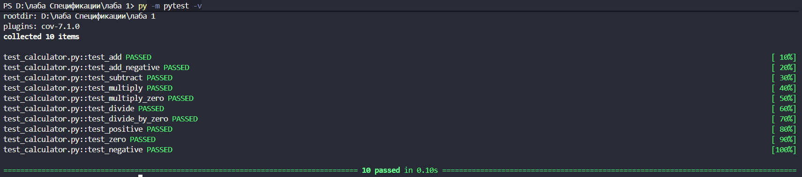
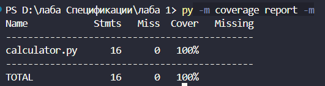

# Лабораторная работа № 1

**Тема:** Критерии качества ПО: сложность, корректность, надёжность, трудоёмкость. Оценка качества ПО.

**Цель:** Освоить практические методы оценки качества и метрик программного обеспечения.

**Группа:** ПВ-231. **Выполнил:** Калашников Егор.

## 1. Теоретическая часть

### 1.1. Три наиболее значимые проблемы при разработке сложных программных систем

1. **Рост сложности и связности компонентов.** Чем больше модулей и зависимостей, тем труднее понять последствия изменений. Повышается риск внесения ошибок и затраты на сопровождение.
2. **Обеспечение корректности и надёжности.** Сложная система должна обрабатывать не только нормальные, но и граничные и ошибочные ситуации.
3. **Оценка трудоёмкости и координация разработки.** Требования меняются, оценки времени бывают неточными, а несогласованность задач затрудняет контроль сроков.

### 1.2. Таблица Проблемы и решения

| Проблема | Возможное решение | Инструменты / методы |
|---|---|---|
| Рост сложности системы | Модульная организация кода, упрощение функций и контроль зависимостей | Разделение на модули, code review, рефакторинг |
| Ошибки и низкая надёжность | Проверка ожидаемых и ошибочных сценариев, автоматизация регрессионного тестирования | тестирование, обработка исключений |
| Неопределённость трудоёмкости | Разбиение работы на измеримые задачи, фиксация статусов и критериев готовности | Инструменты для управления проектами и задачами (jira, aspro и тд.), оценка трудозатрат|

## 2. Практическая часть

### 2.1. Описание тестового проекта

Калькулятор на пайтон, содержащий пять функций: сложение, вычитание, умножение, деление и классификация числа. При попытке деления на ноль функция `divide` выкидывает `ValueError`. Для тестирования создан `test_calculator.py` с десятью unit-тестами на `pytest`

Исходный код `calculator.py`:

```python
def add(a, b):
    return a + b


def subtract(a, b):
    return a - b


def multiply(a, b):
    return a * b


def divide(a, b):
    if b == 0:
        raise ValueError("Деление на ноль")
    return a / b


def classify_number(x):
    if x > 0:
        return "positive"
    elif x == 0:
        return "zero"
    else:
        return "negative"
```

### 2.2. Аспро.Cloud

Проект: [Калькулятор](https://egorkalashnikov8.aspro.cloud/_module/st/view/project/24). Все пять задач отмечены выполненными на предоставленном скриншоте.

| № | Задача | Статус |
|---|---|---|
| 1 | Разработка калькулятора на Python | Выполнена |
| 2 | Написание модульных тестов | Выполнена |
| 3 | Проверка покрытия кода тестами | Выполнена |
| 4 | Анализ размера и сложности программы | Выполнена |
| 5 | Подготовка итогового отчёта | Выполнена |

### 2.3. Unit-тестирование

| Тест | Ожидаемое поведение |
|---|---|
| `test_add` | 2 + 3 = 5 |
| `test_add_negative` | −2 + (−3) = −5 |
| `test_subtract` | 10 − 4 = 6 |
| `test_multiply` | 3 × 4 = 12 |
| `test_multiply_zero` | 5 × 0 = 0 |
| `test_divide` | 10 / 2 = 5 |
| `test_divide_by_zero` | при b = 0 возникает ValueError |
| `test_positive` | 5 → positive |
| `test_zero` | 0 → zero |
| `test_negative` | −5 → negative |

**Полученный результат:** 10 тестов из 10 завершились успешно (`10 passed in 0.10s`). Неуспешных тестов не было.



### 2.4. Покрытие кода тестами

По данным `coverage.py`, в `calculator.py` учтено 16 исполняемых операторов (Stmts), непокрытых — 0 (Miss), покрытие — 100%.



### 2.5. Размер ПО (LOC)

| Показатель | Значение |
|---|---:|
| LOC | 25 |
| SLOC | 17 |
| LLOC | 17 |
| Пустые строки (Blank) | 8 |
| Комментарии | 0 |


### 2.6. Цикломатическая сложность

| Функция | V(G) | Категория |
|---|---:|---|
| `add` | 1 | A |
| `subtract` | 1 | A |
| `multiply` | 1 | A |
| `divide` | 2 | A |
| `classify_number` | 3 | A |

Максимальная сложность — 3 у `classify_number`. В функции две независимые проверки: `x > 0` и `x == 0`. 

Через условия:

**V(G) = количество условий + 1 = 2 + 1 = 3.**

Для укрупнённого графа потока управления с `N = 4` узлами, `E = 5` рёбрами и `P = 1` компонентой: 

**V(G) = E − N + 2P = 5 − 4 + 2 = 3.**

Среднее значение для пяти функций: `(1 + 1 + 1 + 2 + 3) / 5 = 1,6`. Все функции имеют класс A по шкале Radon.

### 2.7. Дефектность и время реакции

Все десять предусмотренных тестов пройдены. Поэтому количество зарегистрированных обнаруженных дефектов при данной проверке равно 0. Оценочная плотность обнаруженных дефектов равна `0 / (17 / 1000) = 0` дефектов на KSLOC.

## 3. Итоговая таблица метрик качества

| Метрика | Результат |
|---|---|
| Размер программы, LOC | 25 физических строк |
| Строки исходного кода, SLOC | 17 строк |
| Логические строки, LLOC | 17 строк |
| Пустые строки | 8 |
| Цикломатическая сложность | макс. 3 (A), средняя 1,6 |
| Модульные тесты | 10 из 10 успешно |
| Покрытие операторов | 100% (16 из 16), пропусков 0 |
| Выявленные дефекты | 0 при выполнении 10 тестов |