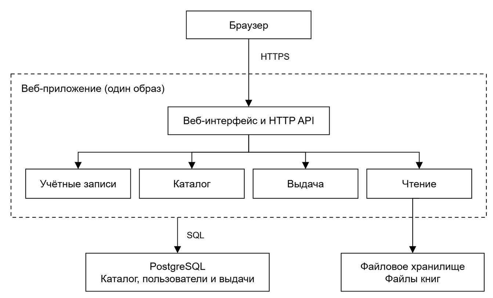
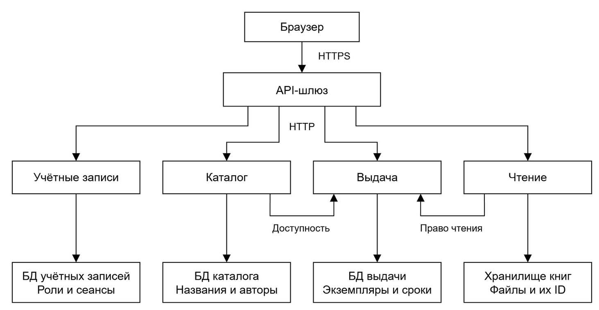
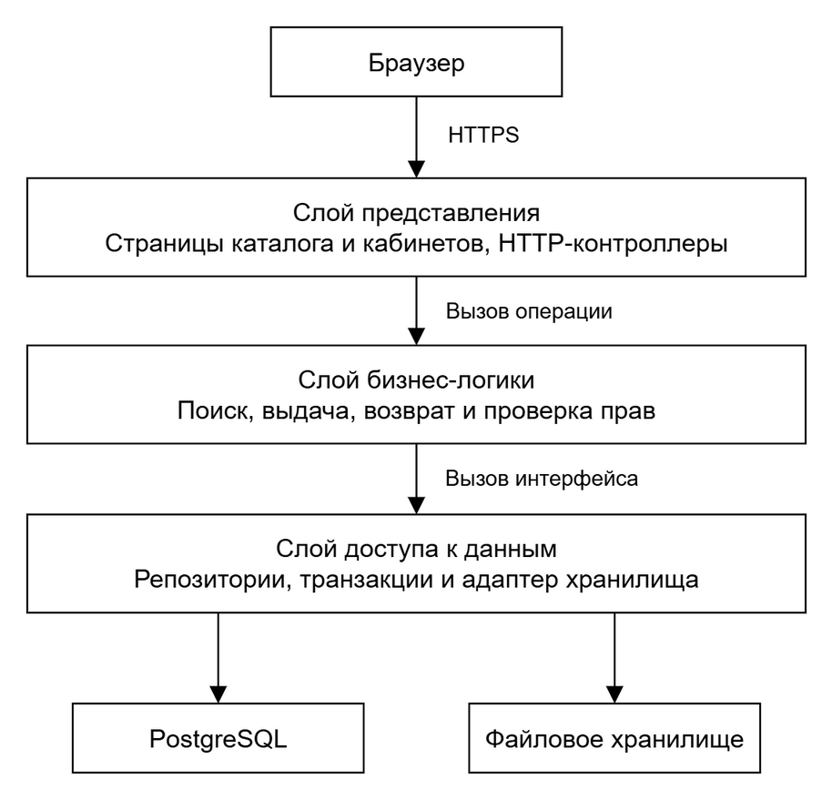
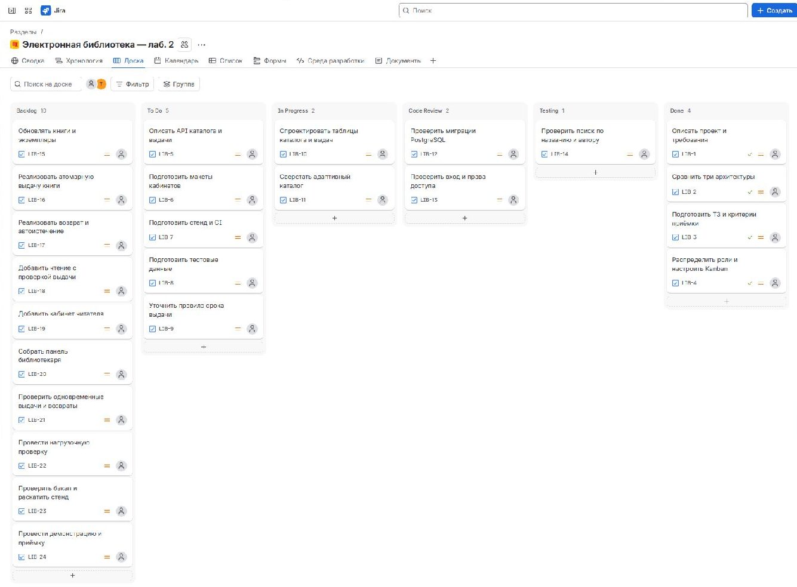
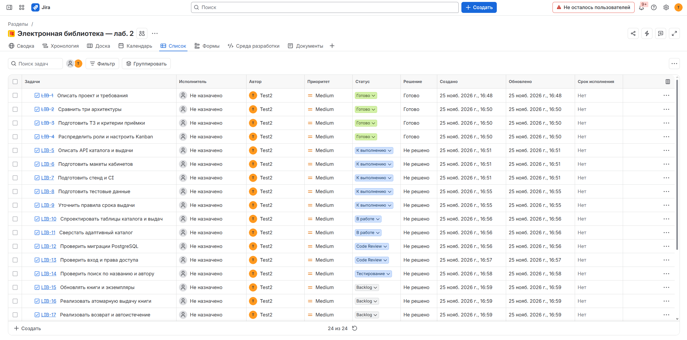

# Лабораторная работа № 2

**Тема** — Анализ требований, выбор архитектуры программного обеспечения и организация командной разработки  
**Проект** — Электронная библиотека  
**Группа** — ПВ-231  
**Выполнил** — Калашников Егор  

**Цель работы** — Получить практические навыки анализа требований к программному обеспечению, проектирования архитектуры информационной системы, формирования команды разработки и распределения задач между участниками проекта.

## 1. Описание проекта

«Электронная библиотека» — веб-сервис учебной библиотеки для поиска и чтения электронных книг. Первая версия рассчитана на одну библиотеку. Для каждой книги библиотекарь задаёт количество лицензированных экземпляров. Один экземпляр можно выдать одному читателю на 14 суток.

| Пользователь | Проблема | Что делает в системе |
|---|---|---|
| Читатель | Приходится уточнять доступность книги и срок выдачи у библиотекаря | Ищет книгу по названию или автору, получает доступ, читает и возвращает её через личный кабинет |
| Библиотекарь | Сложно вручную отслеживать, кому выдан каждый экземпляр | Ведёт каталог, учитывает экземпляры и смотрит активные выдачи |

Читатель и библиотекарь работают через браузер на ПК или телефоне. Сервер и БД размещаются на Linux. Для демонстрации используются тестовые аккаунты и книги, разрешённые к бесплатному распространению.

## 2. Требования к системе

### 2.1. Функциональные требования

| ID | Название | Пользователь | Описание | Ожидаемый результат |
|---|---|---|---|---|
| FR-01 | Вход | Читатель, библиотекарь | Вводит логин и пароль выданной учётной записи | После успешного входа доступны функции своей роли. При неверном пароле вход отклоняется |
| FR-02 | Поиск книг | Читатель | Вводит часть названия или имени автора и при необходимости включает фильтр доступности | Отображаются подходящие книги и количество свободных экземпляров |
| FR-03 | Управление каталогом | Библиотекарь | Добавляет книгу и её файл, меняет описание и число экземпляров | Каталог обновлён. Уменьшение числа экземпляров ниже числа активных выдач отклоняется |
| FR-04 | Выдача книги | Читатель | Нажимает «Взять». Система проверяет доступность и наличие своей активной выдачи этой книги | Создаётся одна выдача на 14 суток. Повтор возвращает существующую выдачу. При отсутствии экземпляров выдача не создаётся |
| FR-05 | Чтение | Читатель | Открывает книгу из личного кабинета | Сервер отдаёт файл, если выдача принадлежит читателю, не возвращена и срок ещё не истёк |
| FR-06 | Возврат | Читатель | Возвращает книгу через кабинет. По окончании срока система закрывает выдачу автоматически | После возврата или истечения срока экземпляр снова доступен, право на чтение прекращается |
| FR-07 | Личный кабинет | Читатель | Открывает список своих выдач | Видны активные и завершённые выдачи, сроки и доступные действия |
| FR-08 | Учёт выдач | Библиотекарь | Просматривает активные выдачи и фильтрует их по книге или сроку | В списке видны книга, экземпляр, читатель и дата окончания выдачи |

### 2.2. Нефункциональные требования

| ID | Категория | Требование |
|---|---|---|
| NFR-01 | Надёжность | На экземпляр приходится максимум одна активная выдача. После сбоя БД копия восстанавливается за 60 минут, потеря данных не превышает 24 часов. Копии БД и файлов делаются ежедневно |
| NFR-02 | Производительность | При 50 одновременных пользователях и 10 000 записей каталога время ответа API для поиска и выдачи не превышает 1 секунду по p95 в 10-минутном прогоне |
| NFR-03 | Безопасность | Доступ по HTTPS, пароли хранятся в виде Argon2id-хешей. Сервер проверяет роль и владельца выдачи. Прямой запрос файла без активной выдачи отклоняется |
| NFR-04 | Масштабируемость | Приложение поддерживает запуск двух экземпляров за прокси. Оба используют общие БД и файловое хранилище. Сеансы сохраняются при переключении между экземплярами |
| NFR-05 | Условия эксплуатации | Стенд работает на Linux с Docker Compose и PostgreSQL. Интерфейс проверяется в Chrome и Firefox на ПК и в Chrome на Android |

Срок выдачи хранится в UTC и показывается в часовом поясе читателя. Доступ к чтению прекращается при проверке запроса сразу после истечения срока. Просроченные записи закрывает фоновая задача. При выдаче система также проверяет срок и при необходимости освобождает экземпляр в той же транзакции.

## 3. Проектирование архитектуры

### 3.1. Монолитная архитектура

Интерфейс и HTTP API собираются в одно веб-приложение. Внутри выделены модули учётных записей, каталога, выдачи и чтения. Они вызывают друг друга через внутренние интерфейсы. При выдаче модуль блокирует запись экземпляра в PostgreSQL и проверяет срок действующей выдачи. Закрытие просроченной и создание новой выдачи выполняются в одной транзакции. Ограничение в БД запрещает две незакрытые выдачи на один экземпляр.

Записи, сеансы и сроки хранятся в общей PostgreSQL. Файлы книг лежат во внутреннем файловом хранилище. Клиент получает их через модуль чтения. Для развёртывания нужны один образ приложения, БД и доступное экземплярам хранилище.

**Плюсы.** Меньше компонентов при развёртывании и отладке. Проверки доступности и изменение данных укладываются в одну транзакцию.

**Минусы.** При изменении одного модуля выпускается весь образ. При росте нагрузки на каталог приходится масштабировать приложение целиком.

### 3.2. Микросервисная архитектура

Браузер обращается через API-шлюз. У каждого сервиса свой выпуск и доступ к своим данным. Статус доступности возвращает сервис выдачи, который отвечает за экземпляры. Каталог хранит описание книг, чтение работает с файлами.

| Сервис | Назначение и функции | Данные | Взаимодействие |
|---|---|---|---|
| Учётные записи | Вход и проверка ролей | Пользователи, пароли, роли, сеансы | Принимает запросы через шлюз. Шлюз использует его API для проверки сеанса |
| Каталог | Поиск и редактирование карточек | Названия, авторы, описания | Запрашивает у выдачи количество свободных экземпляров по ID книг |
| Выдача | Управление экземплярами, выдача, возврат и закрытие по сроку | Экземпляры, выдачи, сроки | Обслуживает команды через шлюз. Отвечает каталогу о доступности и сервису чтения о праве доступа |
| Чтение | Приём файлов от библиотекаря и чтение книги | Файлы книг, связь файла с ID книги | Перед отдачей файла запрашивает право чтения у сервиса выдачи по ID читателя и книги |

Сервисы взаимодействуют по HTTP API. При недоступности сервиса выдачи чтение возвращает временную ошибку. Каталог может показать результаты с пометкой «доступность временно неизвестна». Управление карточкой книги, файлом и экземплярами в этом варианте состоит из отдельных операций. Карточка публикуется после подтверждения загрузки файла и настройки экземпляров.

### 3.3. Многослойная архитектура

| Слой | Назначение и компоненты | Взаимодействие |
|---|---|---|
| Представление | Страницы каталога и кабинетов, HTTP-контроллеры | Принимает запросы и вызывает бизнес-операции. Преобразует результат в страницу или HTTP-ответ |
| Бизнес-логика | Вход, поиск, выдача, возврат, проверка срока и прав чтения | Проверяет правила и задаёт границы транзакций. Обращается к репозиториям и хранилищу через интерфейсы |
| Доступ к данным | Репозитории PostgreSQL, транзакции, адаптер файлового хранилища | Выполняет запросы к БД и операции с файлами, возвращает результат бизнес-слою |

Для первой версии я выбрал модульный монолит с тремя слоями. Один образ проще выпускать небольшой команде. Общая БД позволяет атомарно проверять доступность экземпляра и сохранять выдачу. Слои разделяют веб-интерфейс, правила выдачи и хранение данных.

## 4. Техническое задание

### 4.1. Введение

Наименование системы — «Электронная библиотека». Система ведёт каталог и учёт электронных экземпляров, выдаёт читателям временный доступ к книгам и фиксирует их возврат.

### 4.2. Основания для разработки

Основание — задание на лабораторную работу. Условный заказчик — учебная библиотека. Ей нужны актуальный каталог, выдача по числу лицензий и учёт сроков.

### 4.3. Назначение и цели создания системы

Система автоматизирует поиск, выдачу и возврат электронных книг. Цель первой версии — дать читателю возможность самостоятельно пройти весь цикл, а библиотекарю видеть доступность экземпляров и активные выдачи.

### 4.4. Требования к системе

Функции системы заданы в FR-01–FR-08. Для надёжности действуют требования NFR-01, для производительности — NFR-02, для защиты данных — NFR-03, для масштабирования — NFR-04, для условий эксплуатации — NFR-05. Архитектура первой версии описана в разделе 3.

### 4.5. Состав и содержание работ

| Этап | Работы | Результат |
|---|---|---|
| Анализ и проектирование | Уточнить сценарии, выбрать архитектуру, составить ТЗ и план | Требования, схемы, ТЗ и доска задач |
| Подготовка | Описать API, спроектировать БД, подготовить макеты, стенд и тестовые данные | Контракт API, миграции, макеты, стенд |
| Реализация | Собрать каталог, кабинеты, выдачу, чтение и возврат | Сборка с основными функциями |
| Проверка и сдача | Пройти сценарии, замерить время ответа, проверить восстановление | Результаты тестов, протокол приёмки и инструкции |

### 4.6. Порядок контроля и приёмки

| Проверка | Критерий приёмки |
|---|---|
| Вход и права | Неверный пароль отклоняется. Читатель не может менять каталог или открыть чужую выдачу. Библиотекарь видит активные выдачи. FR-01, FR-08, NFR-03 |
| Каталог | Библиотекарь добавляет книгу и экземпляр. Читатель находит книгу по части названия и имени автора. Фильтр доступности учитывает выдачу. FR-02, FR-03 |
| Выдача и чтение | Два читателя одновременно запрашивают последний экземпляр. Один получает выдачу, второй получает отказ. Повтор победившего запроса возвращает ту же выдачу. Чтение доступно её владельцу. FR-04, FR-05, NFR-01 |
| Возврат, срок и кабинет | Выдача отражается в кабинете. Ручной возврат и окончание срока освобождают экземпляр, повторный запрос файла отклоняется. FR-06, FR-07 |
| Стенд | Пройдены 10-минутный нагрузочный прогон, восстановление копии, проверка сеанса на двух экземплярах приложения и проверки браузеров. NFR-01–NFR-05 |

На демонстрации библиотекарь добавляет книгу, читатель находит её, берёт, открывает и возвращает. Затем показываются результаты проверок конкурентной выдачи, прав, нагрузки и восстановления. Система принимается после прохождения перечисленных проверок и передачи документации. Результаты фиксируются в протоколе.

### 4.7. Требования к составу и содержанию документации

Подготовить ТЗ, схемы архитектуры и БД, описание HTTP API, инструкции пользователям и по развёртыванию, инструкцию восстановления и протокол приёмки.

### 4.8. Источники разработки

- [Задание на лабораторную работу](https://github.com/d26dodenko/PV-231/blob/main/Specification/Total.md).
- [ГОСТ 34.602-89](https://protect.gost.ru/gost/details/192a6558-e2c5-49b4-baa6-5dcad1636888).

## 5. Команда разработки

Команда из семи человек. Frontend и backend отвечают за представление и бизнес-логику. Разработчик БД готовит схему, ограничения и миграции. DevOps выпускает единый образ приложения.

| Роль | Обязанности | Задачи | Результат |
|---|---|---|---|
| Руководитель проекта | Планирование, распределение работ, приёмка | LIB-3, LIB-4, LIB-24 | ТЗ, доска, протокол приёмки |
| Системный аналитик | Требования, архитектура и правила выдачи | LIB-1, LIB-2, LIB-9 | Требования, три схемы, правила выдачи |
| Frontend-разработчик | Макеты и интерфейсы ролей | LIB-6, LIB-11, LIB-19, LIB-20 | Каталог и кабинеты |
| Backend-разработчик | Контракт API, права, бизнес-правила | LIB-5, LIB-13, LIB-15–LIB-18 | API каталога, выдачи, чтения и возврата |
| Разработчик БД | Модель данных и ограничения целостности | LIB-10, LIB-12 | Схема БД и миграции |
| Тестировщик | Подготовка данных и проверка требований | LIB-8, LIB-14, LIB-21, LIB-22 | Набор сценариев и результаты проверок |
| DevOps-инженер | CI, развёртывание и резервное копирование | LIB-7, LIB-23 | Рабочий стенд, образ и проверенная процедура восстановления |

## 6. Доска задач в Jira

Для проекта создана [Kanban-доска](https://forpractice.atlassian.net/jira/software/projects/LIB/boards/131) с 24 карточками. В каждой колонке есть задачи.

| Этап | Что означает | Карточек |
|---|---|---:|
| Backlog | Запланировано и ждёт своей очереди | 10 |
| To Do | Можно брать в работу | 5 |
| In Progress | Исполнитель работает над задачей | 2 |
| Code Review | Изменения переданы на проверку | 2 |
| Testing | Результат проверяется по критериям готовности | 1 |
| Done | Задача завершена | 4 |

В Done помещены материалы, подготовленные для лабораторной. Роли и критерии готовности указаны в таблице.

| Карточка | Задача | Ответственная роль | Этап | Критерий готовности |
|---|---|---|---|---|
| LIB-1 | Описать проект и требования | Аналитик | Done | Зафиксированы роли, границы системы и FR-01–FR-08, NFR-01–NFR-05. |
| LIB-2 | Сравнить три архитектуры | Аналитик | Done | Есть три схемы и обоснование выбора для первой версии. |
| LIB-3 | Подготовить ТЗ и критерии приёмки | Руководитель | Done | Готовы восемь разделов ТЗ и сценарии приёмки. |
| LIB-4 | Распределить роли и настроить Kanban | Руководитель | Done | Определены семь ролей, на доске шесть этапов. |
| LIB-5 | Описать API каталога и выдачи | Backend | To Do | В OpenAPI указаны поля, права и ответы 401, 403 и 409. |
| LIB-6 | Подготовить макеты кабинетов | Frontend | To Do | Есть макеты каталога, кабинета читателя и панели библиотекаря. |
| LIB-7 | Подготовить стенд и CI | DevOps | To Do | CI запускает тесты, Docker Compose поднимает приложение и БД. |
| LIB-8 | Подготовить тестовые данные | Тестировщик | To Do | Есть две роли, два читателя, доступный и выданный экземпляры. |
| LIB-9 | Уточнить правила срока выдачи | Аналитик | To Do | Описаны срок, часовой пояс и освобождение экземпляра. |
| LIB-10 | Спроектировать таблицы каталога и выдач | Разработчик БД | In Progress | ER-схема связывает книгу, экземпляр, выдачу и читателя. |
| LIB-11 | Сверстать адаптивный каталог | Frontend | In Progress | Поиск, фильтр и карточка книги помещаются на мобильном экране. |
| LIB-12 | Проверить миграции PostgreSQL | Разработчик БД | Code Review | Миграции проходят на чистой БД. Ограничения запрещают две активные выдачи. |
| LIB-13 | Проверить вход и права доступа | Backend | Code Review | Пароли хешируются, доступ к чужим выдачам закрыт. |
| LIB-14 | Проверить поиск по названию и автору | Тестировщик | Testing | Поиск и фильтр доступности возвращают ожидаемые книги. |
| LIB-15 | Обновлять книги и экземпляры | Backend | Backlog | Библиотекарь может добавить книгу и менять карточки и число лицензий. |
| LIB-16 | Реализовать атомарную выдачу книги | Backend | Backlog | Два запроса на последний экземпляр дают одну активную выдачу. |
| LIB-17 | Реализовать возврат и автоистечение | Backend | Backlog | Экземпляр освобождается один раз при возврате или истечении срока. |
| LIB-18 | Добавить чтение с проверкой выдачи | Backend | Backlog | Файл доступен читающему по активной выдаче. После возврата доступ закрыт. |
| LIB-19 | Добавить кабинет читателя | Frontend | Backlog | Видны свои выдачи, сроки и кнопки чтения и возврата. |
| LIB-20 | Собрать панель библиотекаря | Frontend | Backlog | Доступны редактирование каталога и просмотр активных выдач. |
| LIB-21 | Проверить одновременные выдачи и возвраты | Тестировщик | Backlog | Интеграционные тесты подтверждают отсутствие двойных выдач. |
| LIB-22 | Провести нагрузочную проверку | Тестировщик | Backlog | Измерен p95 поиска и выдачи по NFR-02. |
| LIB-23 | Проверить бэкап и раскатить стенд | DevOps | Backlog | Подтверждены NFR-01 и NFR-04, на стенде включён HTTPS. |
| LIB-24 | Провести демонстрацию и приёмку | Руководитель | Backlog | В протоколе зафиксированы результаты проверок из раздела 4.6. |

## Заключение

В ходе выполнения лабораторной работы я сформулировал требования, сравнил три архитектуры, описал тех. задачу, и распределил работы между семью ролями на Kanban-доске Jira для проекта электронной библиотеки.
