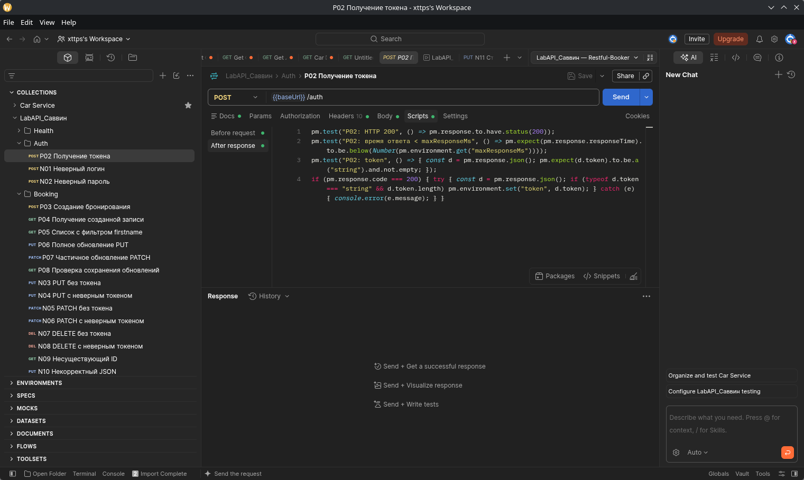
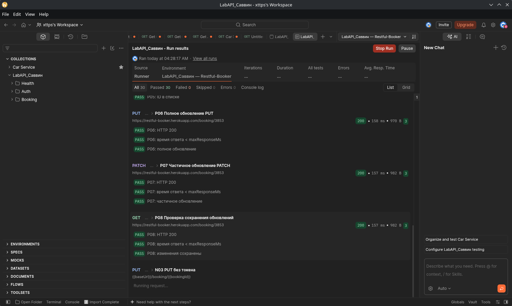
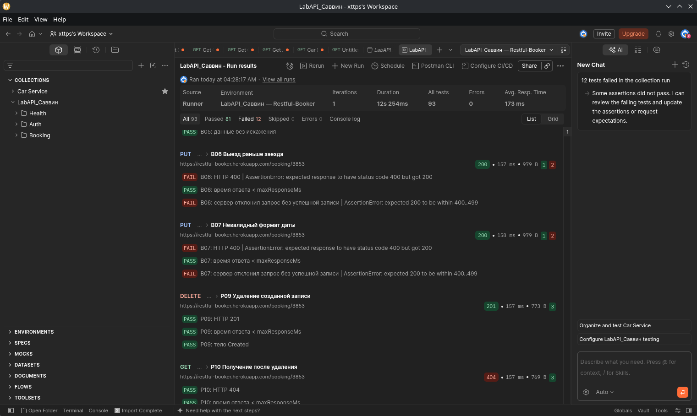
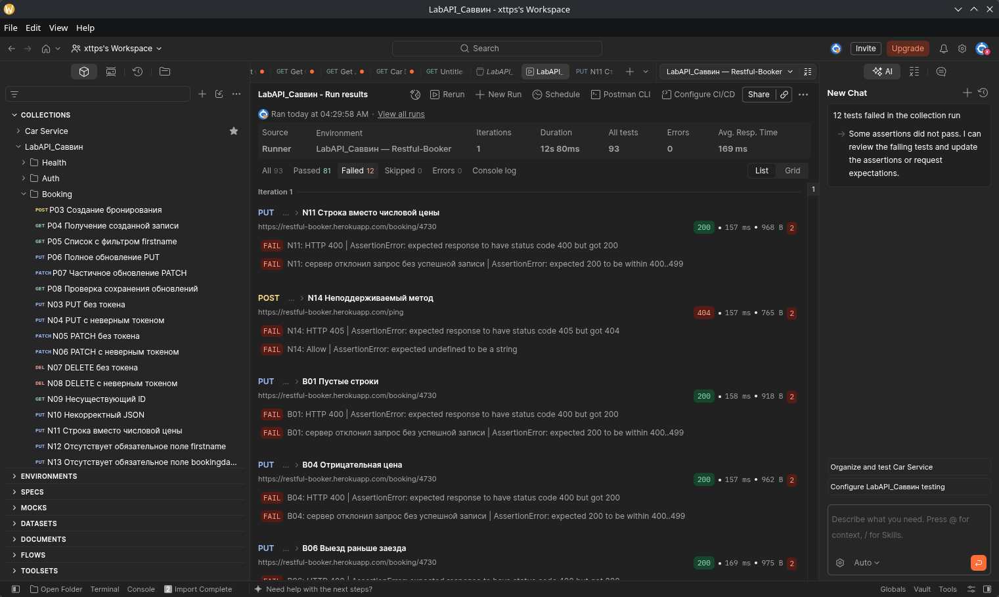

# Лабораторная работа №2

**«Интеграционное и API-тестирование»**

**Выполнил:** Саввин Богдан, группа ПВ-231.

## 1. Цель работы

Научиться проверять REST API в Postman: составлять запросы, писать автоматические тесты и разбирать случаи, когда ответ сервера отличается от ожидаемого.

## 2. Какой сервис я проверял

Для работы я использовал **Restful-Booker** — учебный API для бронирования отелей. Через него можно создать бронирование, посмотреть его данные, изменить их и удалить запись. Адрес сервиса: https://restful-booker.herokuapp.com. При составлении тестов я опирался на [документацию API](https://restful-booker.herokuapp.com/apidoc/index.html).

| Метод | Эндпоинт | Назначение |
|---|---|---|
| POST | `/auth` | Получение токена |
| GET | `/booking` | Получение списка ID, поиск по имени |
| GET | `/booking/{id}` | Получение бронирования |
| POST | `/booking` | Создание бронирования |
| PUT | `/booking/{id}` | Полное обновление |
| PATCH | `/booking/{id}` | Частичное обновление |
| DELETE | `/booking/{id}` | Удаление |
| GET | `/ping` | Проверка доступности сервиса |

## 3. Подготовка запросов в Postman

Я собрал коллекцию **LabAPI_Саввин** и разделил её на три папки: **Health** — проверка доступности, **Auth** — авторизация, **Booking** — работа с бронированиями. Всего получилось 31 запрос. В описании каждого я указал, для чего он нужен, какие данные передаются и какой ответ ожидается.

Чтобы передавать данные между запросами, я настроил окружение со следующими переменными:

| Переменная | Назначение |
|---|---|
| `baseUrl` | Адрес Restful-Booker |
| `token` | Токен из успешного ответа POST /auth |
| `bookingId` | ID записи, созданной в текущем прогоне |
| `runFirstname` | Уникальное имя для поиска собственной записи |
| `longString` | Строка из 1001 символа A для проверки границы длины |
| `maxResponseMs` | Порог времени ответа — 2000 мс |

Для авторизации использовал учебную учётную запись `admin / password123`. После успешного входа скрипт записывает токен в `token`, а после создания бронирования — его номер в `bookingId`. Дальше Postman сам подставляет ID в адрес запроса и токен в заголовок `Cookie: token={{token}}`.

Эти действия выполняются во вкладке **Scripts → After response (Tests)**. Ниже приведены фрагменты сохранения переменных:

```javascript
// P02: сохранить токен из успешного ответа авторизации
if (pm.response.code === 200) {
    const data = pm.response.json();
    if (typeof data.token === "string" && data.token.length > 0) {
        pm.environment.set("token", data.token);
    }
}

// P03: сохранить ID созданного бронирования
if (pm.response.code === 200) {
    const data = pm.response.json();
    if (Number.isInteger(data.bookingid) && data.bookingid > 0) {
        pm.environment.set("bookingId", String(data.bookingid));
    }
}
```

Перед каждым прогоном старые token и bookingId очищаются. Запросы с неверным логином и паролем не меняют уже полученный рабочий токен. Если создание записи не удалось и ID отсутствует, запросы к этой записи пропускаются. В полных скриптах также предусмотрена обработка ошибок при чтении JSON.

Для создания бронирования я использовал такое тело запроса:

```json
{
  "firstname": "{{runFirstname}}",
  "lastname": "Savvin",
  "totalprice": 150,
  "depositpaid": true,
  "bookingdates": {
    "checkin": "2027-01-10",
    "checkout": "2027-01-15"
  },
  "additionalneeds": "Breakfast"
}
```

В PUT-запросе P06 я менял фамилию на `SavvinUpdated`, а цену — на 250. Затем в PATCH-запросе P07 изменял только `additionalneeds` на `Late checkout`. После этого выполнялся GET P08, чтобы проверить, что изменения сохранились.

Для каждого запроса я добавил по три проверки: код ответа, время менее 2000 мс и содержимое ответа. Всего получилось **93 проверки**. Например, при создании бронирования тест сравнивает полученные данные с отправленным JSON.

Коллекцию запускал через **Collection Runner**: одна итерация, задержка 200 мс между запросами. Я включил **Run collection without using stored cookies**, чтобы сохранённый токен не повлиял на проверки без авторизации. Для всех изменений использовалась только запись, созданная в текущем прогоне. В конце она удалялась.

## 4. Тест-кейсы

Запросы выполнялись по порядку с выбранным окружением. В таблицах `{id}` — это `{{bookingId}}` созданной записи, а `{missingId}` — отсутствующий ID 999999999. Под полным телом запроса понимается JSON из раздела 3 с изменениями, указанными в конкретном тесте.

Статус **Passed (3/3)** означает, что все три проверки прошли. В случаях **Failed (1/3)** прошла только проверка времени, а две остальные выявили расхождение. В обоих прогонах коды ответов и результаты тестов совпали.

### 4.1. Позитивные сценарии

| ID | Тип | Запрос | Входные данные | Ожидалось | Получено | Статус |
|---|---|---|---|---|---|---|
| P01 | Позитивный | `GET /ping` | нет | HTTP 201; текст Created | HTTP 201; Created | Passed (3/3) |
| P02 | Позитивный | `POST /auth` | admin / password123 | HTTP 200; непустой строковый token; сохранить token | HTTP 200; получен непустой token; сохранён автоматически | Passed (3/3) |
| P03 | Позитивный | `POST /booking` | полное валидное тело, цена 150 | HTTP 200; bookingid > 0 и booking совпадает с запросом; сохранить bookingId | HTTP 200; bookingid=3853 / 4730; все поля совпали с запросом | Passed (3/3) |
| P04 | Позитивный | `GET /booking/{id}` | bookingId из P03 | HTTP 200; все поля совпадают с P03 | HTTP 200; поля совпали с P03 | Passed (3/3) |
| P05 | Позитивный | `GET /booking?firstname={{runFirstname}}` | уникальный firstname из P03 | HTTP 200; массив содержит bookingId | HTTP 200; массив содержит собственный bookingid | Passed (3/3) |
| P06 | Позитивный | `PUT /booking/{id}` | Cookie token; полное тело: lastname=SavvinUpdated, totalprice=250 | HTTP 200; все поля совпадают с PUT | HTTP 200; все поля совпали с PUT | Passed (3/3) |
| P07 | Позитивный | `PATCH /booking/{id}` | Cookie token; additionalneeds=Late checkout | HTTP 200; поле изменено, остальные поля сохранены | HTTP 200; additionalneeds=Late checkout; прочие поля сохранены | Passed (3/3) |
| P08 | Позитивный | `GET /booking/{id}` | bookingId | HTTP 200; PUT и PATCH сохранены на сервере | HTTP 200; изменения PUT и PATCH сохранены | Passed (3/3) |
| P09 | Позитивный | `DELETE /booking/{id}` | свой bookingId; Cookie token | HTTP 201; Created; запись удалена | HTTP 201; Created; удалена запись текущего прогона | Passed (3/3) |
| P10 | Позитивный | `GET /booking/{id}` | тот же bookingId | HTTP 404; Not Found | HTTP 404; Not Found; удаление подтверждено | Passed (3/3) |

### 4.2. Негативные сценарии

| ID | Тип | Запрос | Входные данные | Ожидалось | Получено | Статус |
|---|---|---|---|---|---|---|
| N01 | Негативный | `POST /auth` | `wrong-admin / password123` | HTTP 200; reason = Bad credentials, token отсутствует | HTTP 200; reason=Bad credentials; token отсутствует | Passed (3/3) |
| N02 | Негативный | `POST /auth` | `admin / wrong-password` | HTTP 200; reason = Bad credentials, token отсутствует | HTTP 200; reason=Bad credentials; token отсутствует | Passed (3/3) |
| N03 | Негативный | `PUT /booking/{id}` | собственная запись; Cookie отсутствует | HTTP 403; Forbidden; изменение запрещено | HTTP 403; Forbidden | Passed (3/3) |
| N04 | Негативный | `PUT /booking/{id}` | собственная запись; token=invalid-lab-token | HTTP 403; Forbidden; изменение запрещено | HTTP 403; Forbidden | Passed (3/3) |
| N05 | Негативный | `PATCH /booking/{id}` | собственная запись; Cookie отсутствует | HTTP 403; Forbidden; изменение запрещено | HTTP 403; Forbidden | Passed (3/3) |
| N06 | Негативный | `PATCH /booking/{id}` | собственная запись; token=invalid-lab-token | HTTP 403; Forbidden; изменение запрещено | HTTP 403; Forbidden | Passed (3/3) |
| N07 | Негативный | `DELETE /booking/{id}` | собственная запись; Cookie отсутствует | HTTP 403; Forbidden; изменение запрещено | HTTP 403; Forbidden | Passed (3/3) |
| N08 | Негативный | `DELETE /booking/{id}` | собственная запись; token=invalid-lab-token | HTTP 403; Forbidden; изменение запрещено | HTTP 403; Forbidden | Passed (3/3) |
| N09 | Негативный | `GET /booking/{missingId}` | id=999999999 | HTTP 404; Not Found | HTTP 404; Not Found | Passed (3/3) |
| N10 | Негативный | `PUT /booking/{id}` | Cookie token; JSON обрезан после {"firstname": | HTTP 400; ошибка разбора; нет успешного ответа | HTTP 400; непустое тело ошибки; некорректный JSON отклонён | Passed (3/3) |
| N11 | Негативный | `PUT /booking/{id}` | totalprice="abc", остальные поля валидны | HTTP 400; ошибка типа данных | HTTP 200; totalprice=null вместо числа | Failed (1/3) |
| N12 | Негативный | `PUT /booking/{id}` | полное тело без firstname | HTTP 400; ошибка обязательного поля | HTTP 400; непустое тело ошибки; запрос без firstname отклонён | Passed (3/3) |
| N13 | Негативный | `PUT /booking/{id}` | полное тело без bookingdates | HTTP 400; ошибка обязательного поля | HTTP 400; непустое тело ошибки; запрос без bookingdates отклонён | Passed (3/3) |
| N14 | Негативный | `POST /ping` | POST без тела | HTTP 405; Method Not Allowed и заголовок Allow | HTTP 404; заголовок Allow отсутствует | Failed (1/3) |

### 4.3. Граничные значения

| ID | Тип | Запрос | Входные данные | Ожидалось | Получено | Статус |
|---|---|---|---|---|---|---|
| B01 | Граничный | `PUT /booking/{id}` | firstname="", lastname="" | HTTP 400; ошибка валидации | HTTP 200; пустые firstname и lastname приняты | Failed (1/3) |
| B02 | Граничный | `PUT /booking/{id}` | firstname: 1001 символ A | HTTP 200; значение принято без искажения | HTTP 200; 1001 символ A принят без искажения | Passed (3/3) |
| B03 | Граничный | `PUT /booking/{id}` | totalprice=0 | HTTP 200; значение принято без искажения | HTTP 200; totalprice=0 принят без искажения | Passed (3/3) |
| B04 | Граничный | `PUT /booking/{id}` | totalprice=-1 | HTTP 400; ошибка валидации | HTTP 200; totalprice=-1 принят | Failed (1/3) |
| B05 | Граничный | `PUT /booking/{id}` | totalprice=1000000000000 | HTTP 200; значение принято без искажения | HTTP 200; totalprice=1000000000000 принят без искажения | Passed (3/3) |
| B06 | Граничный | `PUT /booking/{id}` | checkin=2027-01-15, checkout=2027-01-10 | HTTP 400; ошибка валидации | HTTP 200; checkin=2027-01-15, checkout=2027-01-10 приняты | Failed (1/3) |
| B07 | Граничный | `PUT /booking/{id}` | checkin=not-a-date | HTTP 400; ошибка валидации | HTTP 200; во втором прогоне checkin="0NaN-aN-aN" | Failed (1/3) |

## 5. Что отличалось от ожидаемого

Для успешных запросов я взял коды из примеров документации. С ошибочными данными оказалось сложнее: документация не всегда указывает, какой именно код должен вернуть сервер. Поэтому в таких тестах я ожидал 400 или 405 и отдельно записывал фактический результат.

| Кейс | Что проверялось | Ожидалось | Получено | Как я оценил результат |
|---|---|---|---|---|
| P03 | Создание бронирования | 200 по документации, хотя при создании ресурса часто используют 201 | 200, ID и данные записи | Ответ совпал с документацией |
| P09 | Удаление бронирования | 201 по примеру API; обычно используют 200 или 204 | 201 Created, после удаления GET вернул 404 | Запись удалена, необычный код приведён в документации |
| P01 | Проверка /ping | 201 по примеру API, хотя обычно ожидают 200 | 201 Created | Особенность сервиса |
| N01, N02 | Неверный логин или пароль | 200 с Bad credentials, без токена | 200, reason=Bad credentials, токена нет | Вход отклонён; об ошибке сервер сообщает в теле ответа |
| N11 | Строка "abc" вместо цены | Отказ 400; в успешном ответе цена должна быть числом | 200, totalprice=null | Ошибка данных в успешном ответе, BUG-01 |
| N14 | POST /ping | 405 и заголовок Allow | 404, Allow отсутствует | Ожидание не совпало с ответом; код 405 документацией не обещан |
| B01 | Пустые имя и фамилия | Отказ 400 | 200, пустые строки приняты | В документации нет явного запрета пустых строк |
| B04 | Отрицательная цена | Отказ 400 | 200, цена -1 принята | Для вывода об ошибке нужно уточнить допустимый диапазон цены |
| B06 | Выезд раньше заезда | Отказ 400 | 200, даты приняты | Правило о порядке дат в документации не указано |
| B07 | Строка not-a-date вместо даты | Отказ 400; в успешном ответе должна быть дата | 200, checkin="0NaN-aN-aN" | Сервер вернул некорректную дату, BUG-02 |

Всего расхождения появились в шести сценариях: **N11, N14, B01, B04, B06 и B07**. Строка вместо цены и неверная дата привели к повреждённым значениям в ответе — эти случаи я оформил как баги. Для пустых имён, отрицательной цены и обратного порядка дат не хватает явно заданных правил, поэтому они остались в таблице наблюдений.

Длинная строка, нулевая и очень большая цена были приняты без потери данных. Запретов на эти значения в документации я не нашёл. В ходе прогонов получены коды **200, 201, 400, 403 и 404**. Ответов с кодами 405 и 500 в этих прогонах не было.

У проверки есть ограничения. Отсутствующие обязательные поля я проверял в PUT, но не в POST. После негативных запросов отдельный GET не выполнялся, поэтому для найденных багов подтверждено содержимое ответа PUT, а не последующее состояние записи. Сохранение корректных изменений проверено в P08. Фильтры по датам в этот набор не входили.

## 6. Найденные ошибки

Оба случая обнаружены 04.11.2026 на Restful-Booker в Postman for Linux 12.34.4. В разделе [UpdateBooking](https://restful-booker.herokuapp.com/apidoc/index.html#api-Booking-UpdateBooking) документации цена описана как Number, то есть число, а даты — как Date. Я ожидал, что неверные значения будут отклонены с кодом 400. Сам код ошибки в документации не указан; основание для баг-репортов — некорректные данные в ответах, которые сервер выдал как успешные.

### BUG-01. При передаче строки вместо цены сервер возвращает null

**Тест:** N11. **Серьёзность:** Major. **Приоритет:** Medium. **Статус:** Новый.

**Подготовка:** получить токен через P02 и создать бронирование через P03.

**Шаги:**

1. В теле запроса из раздела 3 заменить цену на `"totalprice": "abc"`.
2. Выполнить `PUT /booking/{{bookingId}}` с этим телом и заголовками `Content-Type: application/json`, `Accept: application/json`, `Cookie: token={{token}}`.
3. Посмотреть код ответа и значение `totalprice`.

**Ожидалось:** сервер отклонит строку вместо числа. В тесте указан код 400; при успешном ответе цена должна оставаться числом.

**Получено:** HTTP 200 и `"totalprice": null`. Значение null не соответствует указанному в документации типу Number.

Ошибка повторилась в обоих прогонах на записях 3853 и 4730. В обоих ответах получен null. Отдельным GET сохранение этого значения не проверялось.

**Скриншоты:** [отправленные данные](screenshots/n11-request.png), [первый ответ](screenshots/n11-response.png), [ответ повторного прогона](screenshots/n11-repeat-response.png).

### BUG-02. Вместо неверной даты сервер возвращает 0NaN-aN-aN

**Тест:** B07. **Серьёзность:** Major. **Приоритет:** Medium. **Статус:** Новый.

**Подготовка:** получить токен и создать бронирование через P02 и P03.

**Шаги:**

1. В полном теле запроса установить `bookingdates.checkin="not-a-date"`, оставив `checkout="2027-01-15"`.
2. Выполнить `PUT /booking/{{bookingId}}` с этим телом и теми же заголовками, что в BUG-01.
3. Посмотреть код ответа и значение `bookingdates.checkin`.

**Ожидалось:** сервер отклонит неверную дату. В тесте указан код 400; успешный ответ должен содержать действительную дату.

**Получено:** HTTP 200. При просмотре ответа второго прогона в поле checkin оказалось `"0NaN-aN-aN"`, что не является календарной датой.

В обоих прогонах сервер принял неверный ввод с кодом 200. Само значение `0NaN-aN-aN` зафиксировано во втором прогоне. Отдельным GET его сохранение не проверялось.

**Скриншоты:** [отправленные данные](screenshots/b07-request.png), [ответ сервера](screenshots/negative-boundary.png).

## 7. Запуск коллекции и результаты

Я выполнил два прогона всей коллекции с одной итерацией. В таблице указано московское время (UTC+3).

| Показатель | Первый прогон | Повторный прогон |
|---|---|---|
| Начало, 04.11.2026 | 04:28:17 | 04:29:58 |
| Выполнено запросов | 31 | 31 |
| Всего проверок | 93 | 93 |
| Passed / Failed | 81 / 12 | 81 / 12 |
| Skipped / Errors | 0 / 0 | 0 / 0 |
| Сценариев без расхождений | 25 из 31 | 25 из 31 |
| Длительность | 12 с 254 мс | 12 с 80 мс |
| Среднее время ответа | 173 мс | 169 мс |
| ID созданной записи | 3853 | 4730 |
| Проверка удаления | DELETE 201 → GET 404 | DELETE 201 → GET 404 |

В обоих случаях прошла цепочка **создание → чтение → PUT → PATCH → чтение → удаление → GET 404**. Токен и ID передавались автоматически. Обе тестовые записи удалены, все ответы уложились в установленный порог времени.

Во втором прогоне снова упали те же 12 проверок на шести сценариях. Это не 12 разных багов: одна ошибка затрагивает несколько проверок, а часть расхождений связана с предположениями о допустимых данных.

## 8. Скриншоты и файлы

Коллекция с выбранным окружением и скриптом сохранения токена:



Проверка полного и частичного обновления записи:



Первый прогон: итог проверок, удаление записи и ответ 404 после удаления:



Повторный прогон с теми же результатами:



Дополнительно приложены [настройки Runner](screenshots/runner-settings.png), [начало прогона](screenshots/runner-grid-top.png), [негативные проверки](screenshots/runner-grid-middle.png), [граничные проверки и удаление](screenshots/runner-grid-bottom.png), [список расхождений](screenshots/discrepancy.png). Ссылки на запросы и ответы для найденных багов находятся в разделе 6.

Файлы для повторного запуска:

- [Коллекция LabAPI_Саввин](LabAPI_Savvin.postman_collection.json).
- [Окружение Restful-Booker](LabAPI_Savvin.postman_environment.json).

Для повторения нужно импортировать оба файла в Postman, выбрать окружение и нажать **Run** с настройками из раздела 3. Токен и ID вручную заполнять не требуется.

## 9. Вывод

В этой работе я проверил восемь эндпоинтов Restful-Booker и подготовил 31 сценарий: 10 позитивных, 14 негативных и 7 граничных. В каждом из двух прогонов прошла 81 проверка из 93. Создание, чтение, обновление и удаление бронирования работали автоматически. Для строки вместо цены и неверной даты я оформил два баг-репорта.

Во время работы я научился составлять тест-кейсы, писать проверки в Postman и передавать данные между запросами через переменные. На практике убедился, что код 200 ещё не означает корректность ответа: нужно смотреть, какие данные вернул сервер. Также научился сравнивать результат с документацией и отделять найденные ошибки от особенностей API и собственных предположений о его работе.
