# Лабораторная работа №3

**«Автоматизация UI-тестов и построение CI/CD-пайплайна с блокирующими quality gates»**

**Выполнил:** Саввин Богдан, группа ПВ-231.

## 1. Цель работы

Освоить UI-автоматизацию, паттерны проектирования тестов, встраивание тестов в пайплайн непрерывной интеграции и настройку блокирующих quality gates, при которых падение тестов останавливает сборку и релиз.

## 2. Тестируемое приложение

Для работы я взял интернет-магазин Clothify из задания. Интерфейс написан на React и TypeScript. API работает на Express, данные хранятся в MongoDB. Для прогона в тестовую базу загружаются три товара. Фронтенд обращается к локальному API. В каталоге я добавил поиск по части названия без учёта регистра. Также привёл поля размеров, изображений и идентификаторов товаров в корзине и заказе к формату API. [Исходный проект](https://github.com/Sajid788/edgistify-Assignment/tree/1f0a32adea63c9e5a06c8f6e736491db6b61ae61)

## 3. UI-тесты на Playwright

Тесты работают в Chromium и используют настоящие запросы к API. Для каждого сценария Playwright создаёт отдельный контекст браузера. В сценарии регистрации пользователь создаётся через форму. В сценариях, требующих готовую учётную запись, она создаётся через API с уникальным email. Для оформления заказа корзина готовится через API, чтобы проверка оформления могла пройти независимо от теста добавления товара.

| ID | Сценарий | Что проверяется | Результат |
| --- | --- | --- | --- |
| UI-01 | Регистрация | API возвращает 200, появляется сообщение об успехе, открывается форма входа | Прошёл |
| UI-02 | Вход | После ввода данных появляется кнопка Logout и открывается защищённая корзина | Прошёл |
| UI-03 | Поиск | Запрос `  cHeCk  ` показывает Blue Check Shirt и скрывает контрольный товар. Для неизвестного товара есть сообщение. После очистки запроса контрольный товар снова виден | Прошёл |
| UI-04 | Добавление в корзину | После выбора размера M в корзине видны Blue Check Shirt, количество 1 и сумма $39 | Прошёл |
| UI-05 | Оформление заказа | После заполнения адреса открывается подтверждение. На странице есть ID заказа, адрес, товар, количество 2 и сумма 78 | Прошёл |
| UI-06 | Выход | Пользователь попадает на страницу входа. Повторное открытие корзины требует входа, идентификатор пользователя очищен | Прошёл |

Локаторы и действия вынесены в классы `AuthPage`, `CatalogPage`, `CartPage` и `CheckoutPage`. В сценариях остаются действия пользователя и проверки ожидаемого результата. Например, здесь проверяется, что после выхода корзина снова закрыта для гостя.

```javascript
const auth = await signIn(page, registeredBuyer);
await auth.logoutButton().click();
await expect(page).toHaveURL(/\/login$/);
await expect(auth.logoutButton()).toHaveCount(0);
await new CartPage(page).open();
await expect(page).toHaveURL(/\/login$/);
```

[Сценарии](https://github.com/flyingllama1/clothify-lab3/blob/main/tests/e2e/shop.spec.js) · [Page Object](https://github.com/flyingllama1/clothify-lab3/blob/main/tests/e2e/pages.js) · [Конфигурация Playwright](https://github.com/flyingllama1/clothify-lab3/blob/main/playwright.config.js)

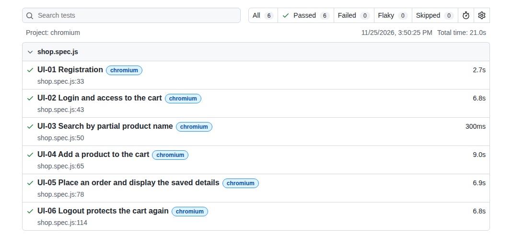

*Рисунок 1. Все шесть сценариев успешно завершились.*

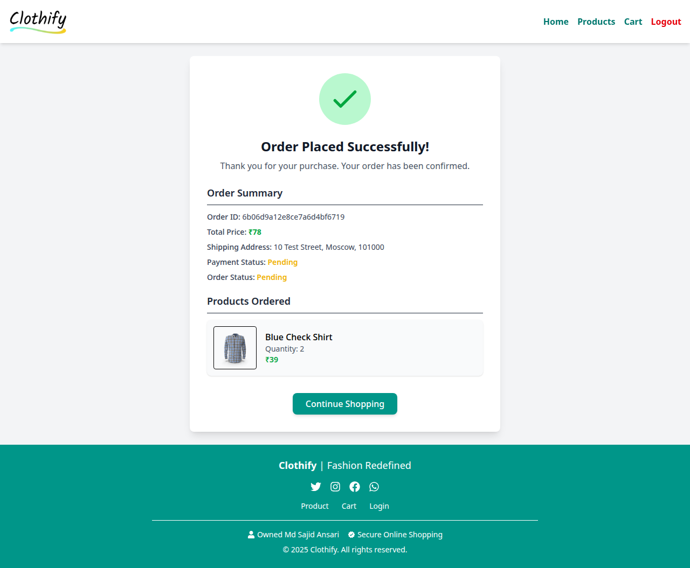

*Рисунок 2. В сценарии UI-05 интерфейс показывает сохранённый заказ с адресом и количеством товара.*

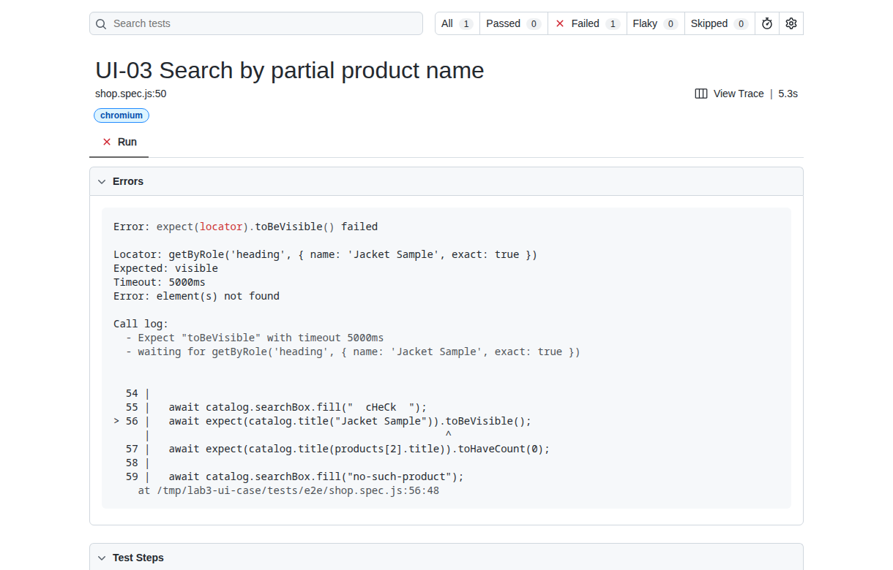

*Рисунок 3. Для проверки диагностики в отдельной копии теста UI-03 я временно указал ожидаемый товар Jacket Sample. Playwright показал неудавшуюся проверку и сохранил снимок и трассировку.*

## 4. Пирамида тестирования

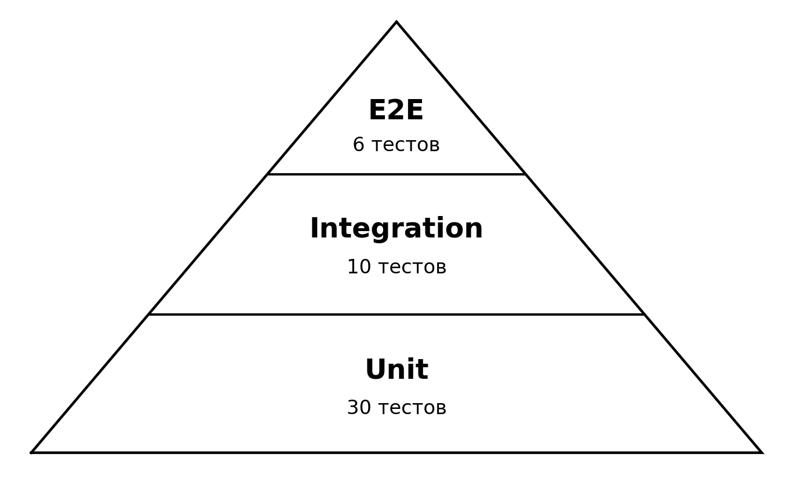

| Уровень | Тестов | Что проверяется и почему |
| --- | ---: | --- |
| Unit | 30 | Поиск и размеры товара, контроллеры, обработка ошибок и проверка токена. Для разных входных данных подменяются обращения к моделям. Тесты запускаются без сети и базы |
| Integration | 10 | HTTP-маршруты Express, валидация, авторизация и сохранение данных в MongoDB. Реальная база нужна, чтобы проверить взаимодействие компонентов |
| E2E | 6 | Основные действия покупателя. Браузер проверяет связку интерфейса и API, а подробные проверки отдельных функций остаются на нижних уровнях |

Из 46 проверок 65% приходится на unit, 22% на integration и 13% на E2E. Модульными тестами удобно покрывать варианты входных данных. Интеграционные проверяют обмен между компонентами. Браузерные проверки оставлены для основных пользовательских сценариев, поскольку каждый такой тест запускает больше компонентов.

## 5. GitHub Actions и quality gates

Workflow запускается на каждый `push` и `pull_request`. Jobs `unit` и `security` запускаются параллельно. Дальнейшие зависимости заданы через `needs`.

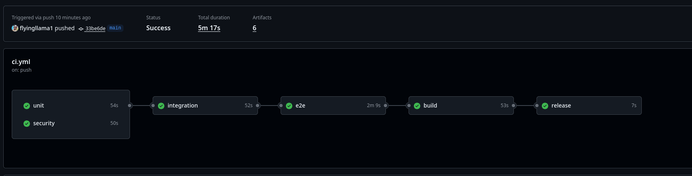

Job `unit` выполняет ESLint и модульные тесты. `c8` требует не менее 80% покрытия строк. В расчёт входят Express-приложение, маршруты, контроллеры, модели, middleware и функции каталога. Компоненты React проверяются через браузер. В успешном прогоне GitHub Actions покрытие составило **93,93%**.

Job `security` выполняет `npm audit` для корня, backend и frontend. Этот инструмент проверяет npm-зависимости JavaScript и TypeScript. При категории `critical` job завершается с ошибкой. В итоговом состоянии критических предупреждений нет. Предупреждения уровней high и moderate отражаются в отчёте аудита.

Jobs `integration` и `e2e` используют отдельные экземпляры MongoDB. `build` выполняет проверку TypeScript и сборку фронтенда Vite. Job `release` запускается после успешной сборки при push в `main` и публикует архив приложения как артефакт workflow. В локальном прогоне workflow через `act` прошли все шесть jobs, включая выгрузку архива в локальное хранилище артефактов.

| Проверка | Что было изменено для прогона | Результат |
| --- | --- | --- |
| Падение unit-теста | Для запроса `cHeCk` в unit-тесте указан другой товар | `unit` завершился с ошибкой, зависимая сборка пропущена |
| Покрытие ниже порога | В отдельном прогоне запущены только семь unit-тестов каталога | Все семь тестов прошли, покрытие 2,9%, но `c8` вернул код 1 при пороге 80% |
| Критические предупреждения | Аудит исходных lock-файлов магазина | `npm audit` обнаружил три critical в backend и одно во frontend. Команда job завершилась с кодом 1 |

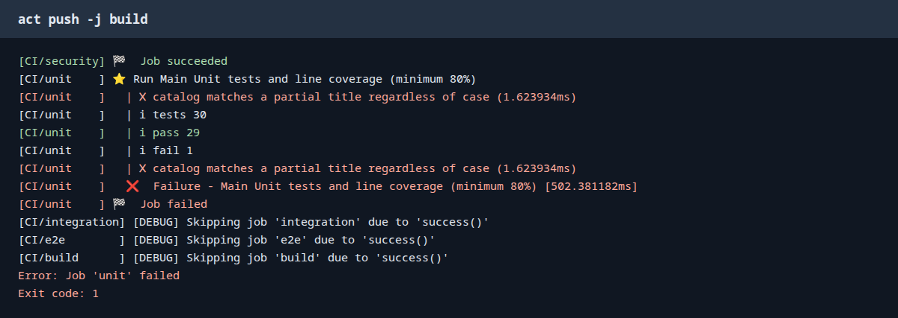

*Рисунок 4. Локальный запуск workflow через act. После падения unit-теста условия запуска зависимых jobs не выполнены.*

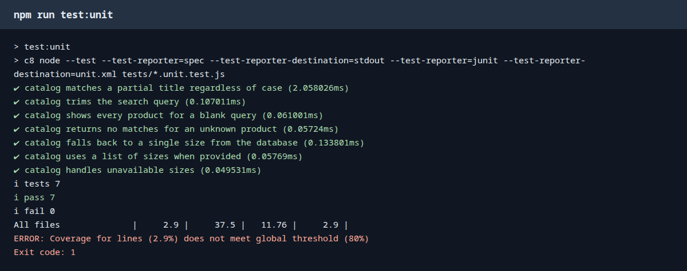

*Рисунок 5. Все семь тестов прошли, однако покрытие строк 2,9% ниже заданных 80%.*

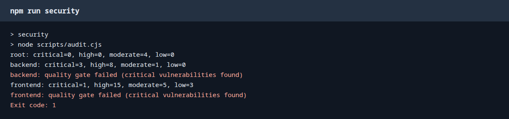

*Рисунок 6. На исходных lock-файлах аудит зарегистрировал критические предупреждения и завершился с ошибкой.*

JUnit-отчёты, отчёт покрытия и материалы Playwright публикуются в Artifacts. Шаги загрузки отчётов выполняются и после неудачных тестов. [Workflow](https://github.com/flyingllama1/clothify-lab3/blob/main/.github/workflows/ci.yml) · [Настройки покрытия](https://github.com/flyingllama1/clothify-lab3/blob/main/.c8rc.json)

Отчёты доступны в разделе **Artifacts** успешного прогона. [Все артефакты](https://github.com/flyingllama1/clothify-lab3/actions/runs/45624152507#artifacts)

### Прогоны на GitHub

[](https://github.com/flyingllama1/clothify-lab3/actions/workflows/ci.yml)

Проект размещён в публичном репозитории. После push в `main` GitHub Actions выполнил все шесть jobs. В разделе **Artifacts** появились отчёты тестов, отчёт покрытия, результаты аудита и архив `clothify-release`. [Репозиторий](https://github.com/flyingllama1/clothify-lab3) · [Успешный прогон CI](https://github.com/flyingllama1/clothify-lab3/actions/runs/45624152507)

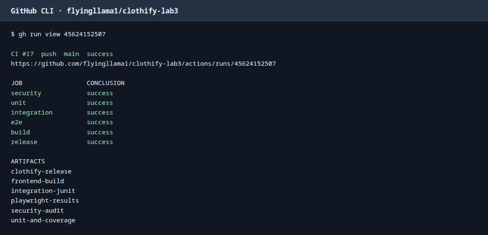

*Рисунок 7. GitHub CLI показывает итоговый статус jobs и список артефактов прогона в main.*

В демонстрационном PR я изменил ожидаемый результат одного теста каталога. Из 30 unit-тестов прошли 29. Job `security` прошёл, а `integration`, `e2e`, `build` и `release` получили статус `skipped`. PR закрыт без слияния. [Демонстрационный PR](https://github.com/flyingllama1/clothify-lab3/pull/1) · [Прогон CI с падением unit-теста](https://github.com/flyingllama1/clothify-lab3/actions/runs/45620523807)

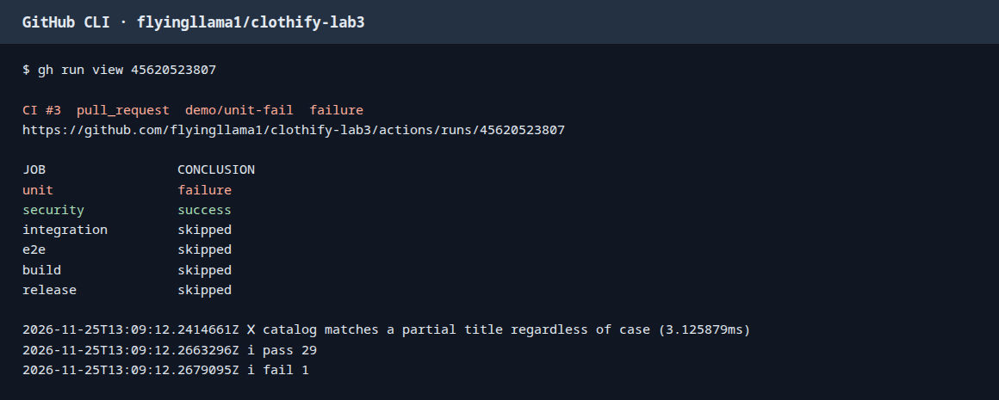

*Рисунок 8. Итог прогона PR в GitHub CLI. Этап `build` пропущен (`skipped`).*

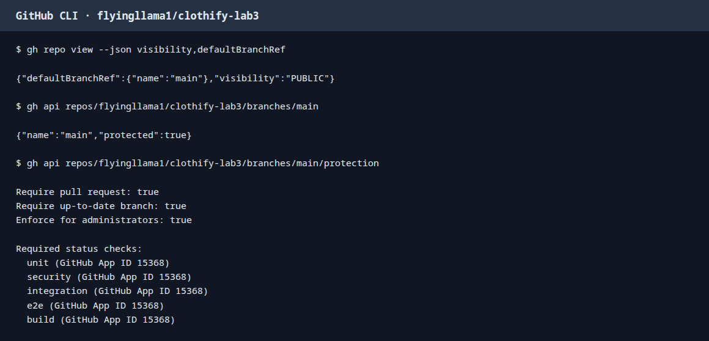

*Рисунок 9. GitHub CLI показывает публичную видимость репозитория, включённую защиту main и обязательные проверки.*

## 6. Контрольные вопросы

[Ответы на контрольные вопросы](Q&A.md)

## 7. Вывод

Я автоматизировал шесть сценариев магазина и разделил остальные проверки между модульными и интеграционными тестами. На контрольных прогонах я проверил, как ошибка теста, снижение покрытия и результат аудита влияют на выполнение следующих стадий. Отчёты Playwright помогают увидеть, на каком действии возникла ошибка, а правила CI не дают подготовить релиз после проваленной проверки.
