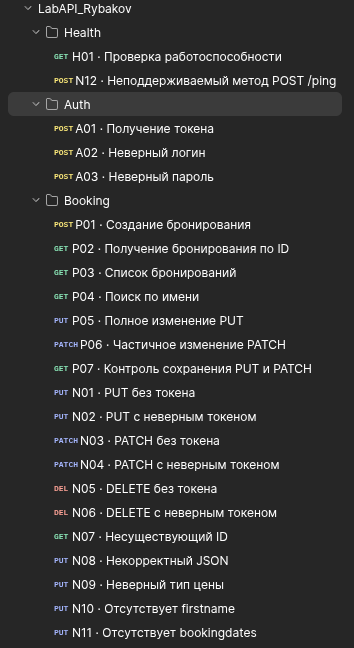
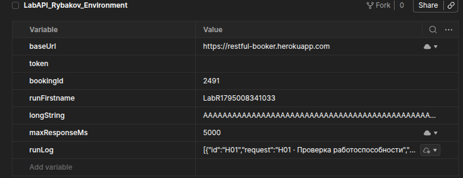
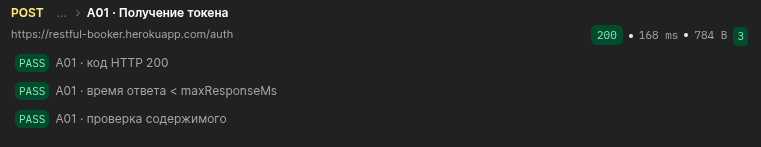
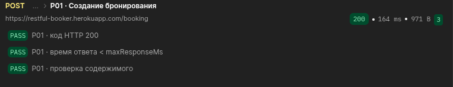
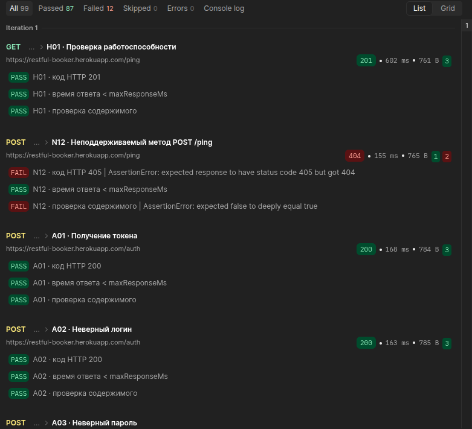
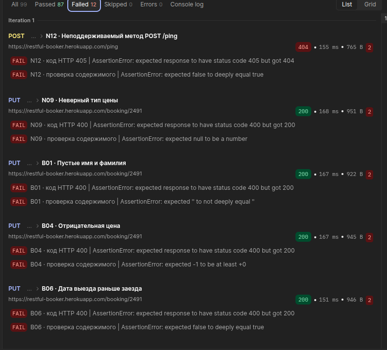
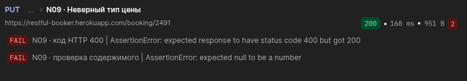
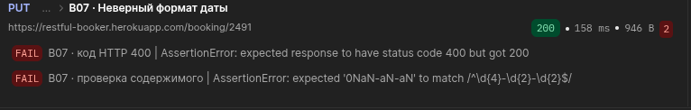
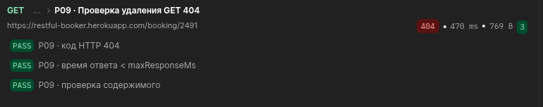

# Тестирование ПО. Рыбаков Илья ПВ-231

# Лабораторная работа №2

**Тема:** Интеграционное и API-тестирование.

**Цель:** Освоить тестирование REST API с использованием Postman, научиться составлять коллекции запросов, автоматизировать проверки, передавать данные между запросами и анализировать расхождения между ожидаемым и фактическим поведением сервиса.

## 1. Тестируемая система

Для тестирования используется **Restful-Booker** — публичное учебное REST API для работы с бронированиями отелей.

- Адрес сервиса: <https://restful-booker.herokuapp.com>.
- Документация: <https://restful-booker.herokuapp.com/apidoc/index.html>.
- Инструмент тестирования: Postman Desktop.
- Формат обмена данными: преимущественно JSON.
- Методы HTTP: `GET`, `POST`, `PUT`, `PATCH`, `DELETE`.

### Тестируемые эндпоинты

| Метод | Эндпоинт | Назначение |
|---|---|---|
| POST | `/auth` | Получение токена авторизации |
| GET | `/booking` | Список идентификаторов бронирований и фильтрация |
| GET | `/booking/{id}` | Получение конкретного бронирования |
| POST | `/booking` | Создание бронирования |
| PUT | `/booking/{id}` | Полное обновление бронирования |
| PATCH | `/booking/{id}` | Частичное обновление бронирования |
| DELETE | `/booking/{id}` | Удаление бронирования |
| GET | `/ping` | Проверка доступности API |

## 2. Подготовка окружения и организация тестирования

Для выполнения работы подготовлена коллекция **`LabAPI_Rybakov`**, содержащая 33 запроса, сгруппированных по ресурсам `Health`, `Auth`, `Booking`.

Используемые переменные окружения:

| Переменная | Назначение |
|---|---|
| `baseUrl` | Базовый адрес тестируемого API |
| `token` | Токен авторизации, автоматически получаемый от `POST /auth` |
| `bookingId` | Идентификатор бронирования, автоматически получаемый от `POST /booking` |
| `runFirstname` | Уникальное имя для поиска тестовой записи |
| `longString` | Строка длиной 1001 символ для граничного теста |
| `maxResponseMs` | Максимально допустимое время ответа — 5000 мс |
| `runLog` | Журнал HTTP-кодов и времени ответа по тест-кейсам |

Для запросов, изменяющих или удаляющих бронирование, используется заголовок `Cookie: token={{token}}`. В конце прогона запись удаляется, а повторный `GET` проверяет отсутствие записи.

Для каждого запроса реализованы **три автоматические проверки**: корректность HTTP-статуса, допустимое время ответа и содержимое ответа. Всего предусмотрено **99 проверок**.

### Пример автоматизации

После авторизации токен сохраняется в окружение:

```javascript
const data = pm.response.json();
if (pm.response.code === 200 && typeof data.token === "string") {
    pm.environment.set("token", data.token);
}
```

После создания бронирования сохраняется его идентификатор:

```javascript
const data = pm.response.json();
if (pm.response.code === 200 && Number.isInteger(data.bookingid)) {
    pm.environment.set("bookingId", String(data.bookingid));
}
```

Пример проверок для создания бронирования:

```javascript
pm.test("Код HTTP 200", () => pm.response.to.have.status(200));
pm.test("Время ответа < 5000 мс", () => pm.expect(pm.response.responseTime).to.be.below(5000));
pm.test("Получен bookingid", () => pm.expect(pm.response.json()).to.have.property("bookingid"));
```

## 3. Тест-кейсы

### 3.1. Позитивные сценарии

| ID | Запрос | Входные данные | Ожидаемый результат | Фактический результат | Статус |
|---|---|---|---|---|---|
| H01 | GET `/ping` | Без тела запроса | 201; `Created` | 201 | PASS |
| A01 | POST `/auth` | `admin / password123` | 200; получен токен | 200; токен получен | PASS |
| P01 | POST `/booking` | Корректный JSON, `totalprice = 150` | 200; `bookingid` сохранён | 200; запись создана | PASS |
| P02 | GET `/booking/{id}` | Сохранённый `bookingId` | 200; данные созданной записи | 200; запись получена | PASS |
| P03 | GET `/booking` | Без фильтров | 200; список ID | 200; массив ID | PASS |
| P04 | GET `/booking?firstname=…` | Имя, сгенерированное для прогона | 200; ID присутствует в выборке | 200; ID найден | PASS |
| P05 | PUT `/booking/{id}` | Фамилия `Updated`, цена 250, токен | 200; все поля обновлены | 200; данные обновлены | PASS |
| P06 | PATCH `/booking/{id}` | `additionalneeds = Late checkout` | 200; выбранное поле изменено | 200; поле изменено | PASS |
| P07 | GET `/booking/{id}` | Проверка после PUT/PATCH | 200; изменения сохранились | 200; изменения обнаружены | PASS |
| P08 | DELETE `/booking/{id}` | Действующий токен и `bookingId` | 201; запись удалена | 201 | PASS |
| P09 | GET `/booking/{id}` | ID удалённой записи | 404; запись не найдена | 404 | PASS |

### 3.2. Негативные сценарии

| ID | Запрос | Входные данные | Ожидаемый результат | Фактический результат | Статус |
|---|---|---|---|---|---|
| N12 | POST `/ping` | Неподдерживаемый метод | 405; заголовок `Allow` | 404 | FAIL |
| A02 | POST `/auth` | Неверный логин | 200; `Bad credentials` | 200; `Bad credentials` | PASS |
| A03 | POST `/auth` | Неверный пароль | 200; `Bad credentials` | 200; `Bad credentials` | PASS |
| N01 | PUT `/booking/{id}` | Без токена | 403; отказ | 403 | PASS |
| N02 | PUT `/booking/{id}` | Неверный токен | 403; отказ | 403 | PASS |
| N03 | PATCH `/booking/{id}` | Без токена | 403; отказ | 403 | PASS |
| N04 | PATCH `/booking/{id}` | Неверный токен | 403; отказ | 403 | PASS |
| N05 | DELETE `/booking/{id}` | Без токена | 403; отказ | 403 | PASS |
| N06 | DELETE `/booking/{id}` | Неверный токен | 403; отказ | 403 | PASS |
| N07 | GET `/booking/999999999` | Отсутствующий ID | 404; запись отсутствует | 404 | PASS |
| N08 | PUT `/booking/{id}` | Обрезанный JSON | 400; отказ | 400 | PASS |
| N09 | PUT `/booking/{id}` | `totalprice = "abc"` | 400; отказ по типу | 200; некорректный тип цены не отклонён | FAIL |
| N10 | PUT `/booking/{id}` | Без поля `firstname` | 400; отказ | 400 | PASS |
| N11 | PUT `/booking/{id}` | Без поля `bookingdates` | 400; отказ | 400 | PASS |
| N13 | POST `/booking` | Обрезанный JSON | 400; отказ | 400 | PASS |

### 3.3. Граничные значения

| ID | Запрос | Входные данные | Ожидаемый результат | Фактический результат | Статус |
|---|---|---|---|---|---|
| B01 | PUT `/booking/{id}` | Пустые `firstname` и `lastname` | 400; пустое имя не принято | 200; пустые значения приняты | FAIL |
| B02 | PUT `/booking/{id}` | Имя из 1001 символа | 200; строка сохранена | 200; строка принята | PASS |
| B03 | PUT `/booking/{id}` | `totalprice = 0` | 200; цена 0 | 200 | PASS |
| B04 | PUT `/booking/{id}` | `totalprice = -1` | 400; отрицательная цена запрещена | 200; цена принята | FAIL |
| B05 | PUT `/booking/{id}` | `totalprice = 1000000000000` | 200; большое число | 200 | PASS |
| B06 | PUT `/booking/{id}` | `checkout` раньше `checkin` | 400; неверный порядок дат | 200; период принят | FAIL |
| B07 | PUT `/booking/{id}` | `checkin = "not-a-date"` | 400; неверный формат даты | 200; дата не прошла проверку формата | FAIL |

## 4. Результаты запуска Collection Runner

Коллекция запущена в Postman через **Collection Runner** в режиме Functional → Local. Выполнена 1 итерация со всеми 33 запросами. Получение токена, создание бронирования, передача идентификатора между запросами, обновление и удаление записи выполнены последовательно без ручного изменения переменных.

| Показатель | Результат |
|---|---:|
| Выполнено запросов | 33 |
| Выполнено автоматических проверок | 99 |
| Успешных проверок | 87 |
| Неуспешных проверок | 12 |
| Сценариев с полностью успешными проверками | 27 |
| Сценариев с расхождениями | 6 |
| Ошибок выполнения HTTP-запросов | 0 |

Во всех сценариях проверка времени ответа прошла успешно: время ответа не превышало установленный предел в 5000 мс. Шесть сценариев (`N09`, `N12`, `B01`, `B04`, `B06`, `B07`) дали несовпадения с ожидаемым поведением. Каждый из них содержит по две непройденные проверки: HTTP-кода и содержимого ответа. HTTP-коды `400`, `403`, `404` в остальных негативных сценариях являются ожидаемыми ответами и не считаются ошибками тестирования.

В ходе прогона было создано бронирование с идентификатором `2491`. Запросы `PUT` и `PATCH` успешно изменили его данные, после чего запрос `DELETE` вернул HTTP 201, а повторный `GET` — HTTP 404, подтвердив удаление.

### Скриншоты тестирования



*Рисунок 1 — Структура коллекции запросов в Postman.*



*Рисунок 2 — Переменные окружения Postman.*



*Рисунок 3 — Запрос POST /auth и выполненные проверки.*



*Рисунок 4 — Ответ на POST /booking и созданный идентификатор.*



*Рисунок 5 — Сводка по количеству запросов, успешных и неуспешных проверок.*



*Рисунок 6 — Тест-кейсы с выявленными расхождениями.*



*Рисунок 7 — Проверка N09 на некорректный тип поля totalprice.*



*Рисунок 8 — Проверка B07 на некорректный формат даты.*



*Рисунок 9 — Повторное получение удалённого бронирования, ответ 404.*

## 5. Анализ расхождений

При выполнении негативных и граничных сценариев обнаружены шесть расхождений между ожидаемыми и фактическими ответами API.

| № | Тест | Ожидаемый результат | Фактический результат | Оценка |
|---|---|---|---|---|
| 1 | N09 — неверный тип `totalprice` | HTTP 400; отклонение строки вместо числа | HTTP 200; проверка числового типа не пройдена | Некорректная обработка типа данных |
| 2 | N12 — `POST /ping` | HTTP 405; заголовок `Allow` | HTTP 404; проверка `Allow` не пройдена | Особенность обработки неподдерживаемого метода |
| 3 | B01 — пустые имя и фамилия | HTTP 400; отказ для пустых строк | HTTP 200; пустые значения приняты | Отсутствие проверки непустых строк |
| 4 | B04 — отрицательная цена | HTTP 400; запрет отрицательной цены | HTTP 200; отрицательное значение принято | Отсутствие проверки диапазона цены |
| 5 | B06 — дата выезда раньше заезда | HTTP 400; отказ для некорректного интервала | HTTP 200; некорректный интервал принят | Отсутствие проверки порядка дат |
| 6 | B07 — неверный формат даты | HTTP 400; отказ для неверной даты | HTTP 200; значение даты не прошло проверку формата | Некорректная обработка формата даты |

Для тестов `B01`, `B04` и `B06` ожидаемые ответы основаны на предполагаемых бизнес-ограничениях сервиса, а не на явно зафиксированных требованиях документации. Эти случаи характеризуют недостаточность валидации входных данных. Ответ `404` для `POST /ping` отдельно рассматривается как особенность обработки маршрутов, а не как подтверждённый дефект бизнес-логики.

### BUG-01. Некорректная обработка типа поля `totalprice`

- **Тест-кейс:** N09.
- **Серьёзность:** Major.
- **Предусловия:** получен действующий токен авторизации; создано тестовое бронирование.
- **Шаги воспроизведения:** отправить `PUT /booking/{{bookingId}}` с действующим токеном и полным JSON-телом, указав `"totalprice": "abc"`.
- **Ожидаемый результат:** HTTP 400; некорректное значение цены отклоняется.
- **Фактический результат:** HTTP 200; проверка числового типа возвращённой цены не пройдена.
- **Вывод:** некорректное значение цены не отклоняется и может нарушить целостность данных бронирования.

### BUG-02. Некорректная обработка формата даты

- **Тест-кейс:** B07.
- **Серьёзность:** Major.
- **Предусловия:** получен действующий токен авторизации; создано тестовое бронирование.
- **Шаги воспроизведения:** отправить `PUT /booking/{{bookingId}}` с `"bookingdates": {"checkin": "not-a-date", "checkout": "2027-02-15"}`.
- **Ожидаемый результат:** HTTP 400; некорректная дата отклоняется.
- **Фактический результат:** HTTP 200; значение `checkin` в ответе не соответствует ожидаемому формату даты `YYYY-MM-DD`.
- **Вывод:** сервис не отклоняет некорректную дату и возвращает значение, не соответствующее ожидаемому формату.

## 6. Материалы лабораторной работы

К отчёту прилагаются:

1. `LabAPI_Rybakov.postman_collection.json` — коллекция запросов Postman с автоматическими проверками.
2. `LabAPI_Rybakov.postman_environment.json` — окружение Postman с используемыми переменными.
3. `screenshots/` — изображения результатов выполнения тестовых сценариев в Collection Runner.

## 7. Вывод

В ходе лабораторной работы выполнено интеграционное и API-тестирование сервиса Restful-Booker с использованием Postman. Были проверены операции авторизации, получения, создания, изменения и удаления бронирований. Для тестирования подготовлена коллекция из 33 запросов с автоматической передачей токена авторизации и идентификатора созданного бронирования.

В результате выполнения 99 автоматических проверок успешно завершились 87, неуспешно — 12. Выявлено шесть сценариев с расхождениями между ожидаемым и фактическим поведением API. Наиболее существенные проблемы связаны с обработкой некорректного типа цены и неверного формата даты; также обнаружено отсутствие некоторых предполагаемых проверок бизнес-ограничений. Позитивная цепочка создания, получения, изменения и удаления бронирования выполнена успешно, что подтверждает работоспособность основных операций API и корректную передачу данных между связанными запросами.
