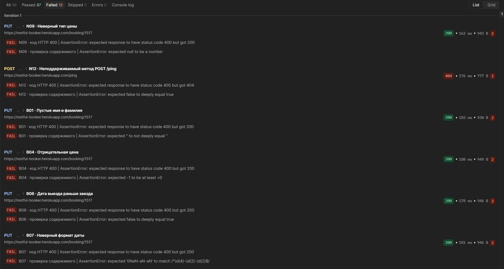
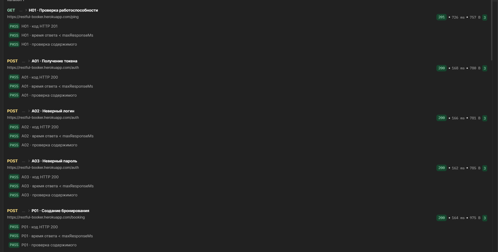

# Лабораторная работа №2. Интеграционное и API-тестирование

**Выполнил:** Калашников Егор, ПВ-231  
**Дисциплина:** Тестирование программных систем

## 1. Цель работы

Освоить тестирование REST API в Postman: создание коллекции запросов, автоматизацию проверок, передачу данных между запросами и анализ расхождений между ожидаемым и фактическим поведением сервиса.

## 2. Тестируемая система

**Restful-Booker** — учебный REST API для управления бронированиями. Адрес сервиса: https://restful-booker.herokuapp.com. [Документация API](https://restful-booker.herokuapp.com/apidoc/index.html).

| Метод | Эндпоинт | Назначение |
|---|---|---|
| POST | `/auth` | Получение токена |
| GET | `/booking` | Список бронирований, фильтрация |
| GET | `/booking/{id}` | Получение бронирования |
| POST | `/booking` | Создание бронирования |
| PUT | `/booking/{id}` | Полное обновление |
| PATCH | `/booking/{id}` | Частичное обновление |
| DELETE | `/booking/{id}` | Удаление |
| GET | `/ping` | Проверка доступности |

Для тестирования создана коллекция из 33 запросов в папках `Health`, `Auth`, `Booking`. Окружение содержит переменные `baseUrl`, `token`, `bookingId`, `runFirstname`, `longString` и `maxResponseMs`. Токен и ID созданного бронирования автоматически сохраняются после ответов `POST /auth` и `POST /booking`. Для авторизованных операций используется `Cookie: token={{token}}`.

Для каждого запроса настроены три проверки: HTTP-код, время ответа и содержимое ответа. Коллекция запускалась в Collection Runner, одна итерация. Проверки выполнялись последовательно; созданное бронирование удалялось в конце прогона.

## 3. Результаты тестирования

| Показатель | Значение |
|---|---:|
| Запросов | 33 |
| Автоматических проверок | 99 |
| Успешных проверок | 87 |
| Неуспешных проверок | 12 |
| Сценариев без ошибок проверок | 27 |
| Сценариев с расхождениями | 6 |
| Ошибок выполнения запросов | 0 |

### 3.1. Позитивные сценарии

| ID | Запрос | Входные данные | Ожидаемый результат | Фактический результат | Статус |
|---|---|---|---|---|---|
| H01 | `GET /ping` | Без параметров | 201; `Created` | 201 | PASS |
| A01 | `POST /auth` | `admin / password123` | 200; токен | 200; токен получен | PASS |
| P01 | `POST /booking` | Валидное бронирование, цена 150 | 200; создан `bookingid` | 200; бронирование создано | PASS |
| P02 | `GET /booking/{id}` | ID созданной записи | 200; данные записи | 200; данные получены | PASS |
| P03 | `GET /booking` | Без фильтров | 200; список ID | 200; список получен | PASS |
| P04 | `GET /booking?firstname=...` | Имя из созданной записи | 200; запись найдена | 200; запись найдена | PASS |
| P05 | `PUT /booking/{id}` | Новая фамилия и цена 250 | 200; запись обновлена | 200; значения обновлены | PASS |
| P06 | `PATCH /booking/{id}` | `additionalneeds: Late checkout` | 200; поле изменено | 200; поле изменено | PASS |
| P07 | `GET /booking/{id}` | Проверка изменений PUT/PATCH | 200; изменения сохранены | 200; изменения подтверждены | PASS |
| P08 | `DELETE /booking/{id}` | ID тестовой записи, токен | 201; запись удалена | 201 | PASS |
| P09 | `GET /booking/{id}` | ID удалённой записи | 404 | 404 | PASS |

### 3.2. Негативные сценарии

| ID | Запрос | Входные данные | Ожидаемый результат | Фактический результат | Статус |
|---|---|---|---|---|---|
| A02 | `POST /auth` | Неверный логин | 200; `Bad credentials` | 200; `Bad credentials` | PASS |
| A03 | `POST /auth` | Неверный пароль | 200; `Bad credentials` | 200; `Bad credentials` | PASS |
| N01 | `PUT /booking/{id}` | Без токена | 403 | 403 | PASS |
| N02 | `PUT /booking/{id}` | Неверный токен | 403 | 403 | PASS |
| N03 | `PATCH /booking/{id}` | Без токена | 403 | 403 | PASS |
| N04 | `PATCH /booking/{id}` | Неверный токен | 403 | 403 | PASS |
| N05 | `DELETE /booking/{id}` | Без токена | 403 | 403 | PASS |
| N06 | `DELETE /booking/{id}` | Неверный токен | 403 | 403 | PASS |
| N07 | `GET /booking/999999999` | Несуществующий ID | 404 | 404 | PASS |
| N08 | `PUT /booking/{id}` | Некорректный JSON | 400 | 400 | PASS |
| N09 | `PUT /booking/{id}` | `totalprice: "abc"` | 400 | 200; `totalprice: null` | FAIL |
| N10 | `PUT /booking/{id}` | Нет `firstname` | 400 | 400 | PASS |
| N11 | `PUT /booking/{id}` | Нет `bookingdates` | 400 | 400 | PASS |
| N12 | `POST /ping` | Неподдерживаемый метод | 405 | 404 | FAIL |
| N13 | `POST /booking` | Некорректный JSON | 400 | 400 | PASS |

### 3.3. Граничные значения

| ID | Запрос | Входные данные | Ожидаемый результат | Фактический результат | Статус |
|---|---|---|---|---|---|
| B01 | `PUT /booking/{id}` | Пустые имя и фамилия | 400 | 200; пустые строки приняты | FAIL |
| B02 | `PUT /booking/{id}` | Имя из 1001 символа | 200 | 200; строка принята | PASS |
| B03 | `PUT /booking/{id}` | `totalprice: 0` | 200 | 200 | PASS |
| B04 | `PUT /booking/{id}` | `totalprice: -1` | 400 | 200; `-1` принят | FAIL |
| B05 | `PUT /booking/{id}` | `totalprice: 1000000000000` | 200 | 200 | PASS |
| B06 | `PUT /booking/{id}` | `checkout` раньше `checkin` | 400 | 200; даты приняты | FAIL |
| B07 | `PUT /booking/{id}` | `checkin: "not-a-date"` | 400 | 200; `0NaN-aN-aN` | FAIL |

### 3.4. Скриншоты

## 4. Анализ расхождений

| № | Тест | Ожидалось | Получено | Оценка |
|---|---|---|---|---|
| 1 | N09: строка вместо цены | 400 | 200; значение цены `null` | Вероятный дефект обработки типа данных |
| 2 | N12: `POST /ping` | 405 | 404 | Особенность маршрутизации API |
| 3 | B01: пустые имена | 400 | 200; значения приняты | Отсутствует предполагаемая проверка непустого значения |
| 4 | B04: отрицательная цена | 400 | 200; значение принято | Отсутствует предполагаемая проверка диапазона |
| 5 | B06: дата выезда раньше заезда | 400 | 200; даты приняты | Отсутствует предполагаемая проверка периода |
| 6 | B07: неверный формат даты | 400 | 200; `0NaN-aN-aN` | Вероятный дефект обработки даты |

### BUG-01. Некорректный тип цены

- **Запрос:** `PUT /booking/{id}` с валидным токеном и `"totalprice": "abc"`.
- **Шаги:** создать бронирование, получить токен, отправить PUT с указанным значением цены.
- **Ожидалось:** HTTP 400, отказ в изменении записи.
- **Получено:** HTTP 200, в ответе `totalprice: null`.
- **Серьёзность:** Major — риск нарушения целостности данных.

### BUG-02. Некорректная дата

- **Запрос:** `PUT /booking/{id}` с `"checkin": "not-a-date"`.
- **Шаги:** создать бронирование, получить токен, отправить PUT с некорректной датой заезда.
- **Ожидалось:** HTTP 400, отказ в изменении записи.
- **Получено:** HTTP 200, дата в ответе преобразована в `0NaN-aN-aN`.
- **Серьёзность:** Major — формирование некорректного значения даты.

## 5. Вывод

В ходе работы было выполнено интеграционное тестирование Restful-Booker в Postman. Проверены все восемь эндпоинтов, реализованы позитивные, негативные и граничные сценарии, настроена автоматическая передача токена и идентификатора бронирования. Collection Runner выполнил 99 проверок: 87 успешных и 12 неуспешных. Выявлено шесть расхождений, из которых два связаны с некорректной обработкой цены и даты. Позитивная цепочка создания, получения, изменения и удаления бронирования прошла успешно.
