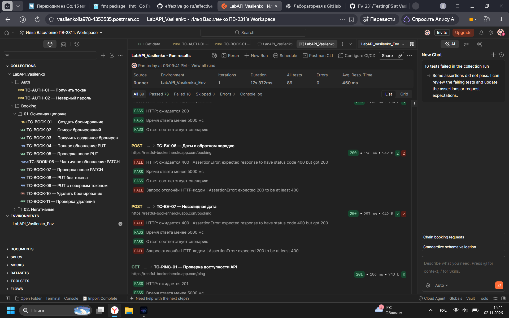
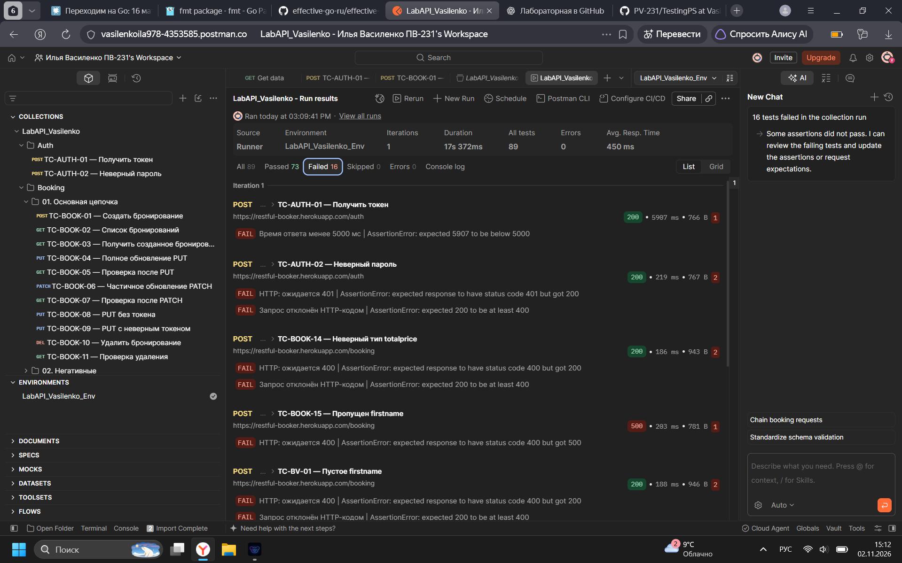
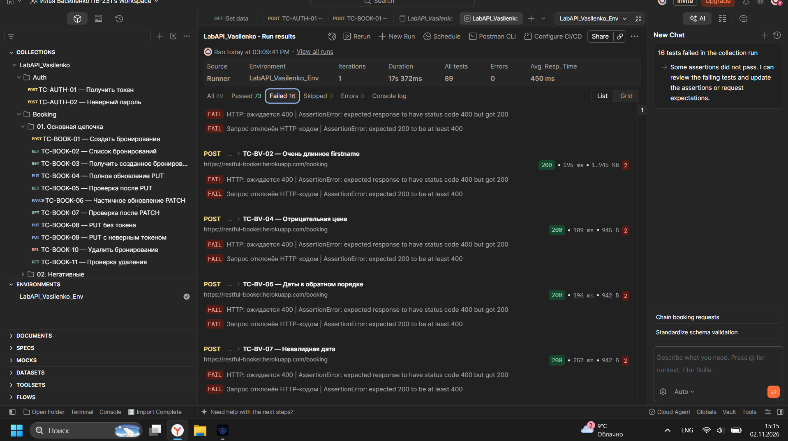

# Лабораторная работа №2 «Интеграционное и API-тестирование»

**Выполнил:** Василенко Илья, группа ПВ-231  
**Инструмент:** Postman Web, Cloud Agent  
**Тестируемая система:** [Restful-Booker](https://restful-booker.herokuapp.com)  
**Документация API:** https://restful-booker.herokuapp.com/apidoc/index.html  
**Дата прогона:** 2 ноября 2026 года

## 1. Цель работы

Изучить интеграционное тестирование REST API в Postman, реализовать автоматизированную цепочку CRUD-запросов, проверить позитивные, негативные и граничные сценарии, сопоставить ожидаемое поведение API с фактическим и оформить найденные отклонения.

## 2. Тестируемые эндпоинты

| Метод | Эндпоинт | Назначение |
| --- | --- | --- |
| POST | `/auth` | Авторизация, получение токена |
| GET | `/booking` | Список бронирований |
| GET | `/booking/{id}` | Получение бронирования |
| POST | `/booking` | Создание бронирования |
| PUT | `/booking/{id}` | Полное обновление |
| PATCH | `/booking/{id}` | Частичное обновление |
| DELETE | `/booking/{id}` | Удаление бронирования |
| GET | `/ping` | Проверка работоспособности сервиса |

## 3. Организация автоматизации

Создана коллекция **`LabAPI_Vasilenko`** из 25 запросов. Запросы распределены по папкам `Auth`, `Booking` (основная цепочка, негативные и граничные значения), `Health`.

Используются переменные окружения:

- `baseUrl` — базовый адрес сервиса.
- `token` — автоматически сохраняется после `POST /auth`.
- `bookingId` — автоматически сохраняется после `POST /booking` и передаётся в запросы `GET`, `PUT`, `PATCH`, `DELETE`.

Для каждого запроса добавлено не менее трёх проверок: HTTP-код, время ответа и содержание/структура результата. Там, где применимо, дополнительно проверяется отклонение невалидных запросов кодом 4xx или сохранение переменных.

Основной сценарий: авторизация → создание бронирования → получение → полное обновление PUT → проверка → частичное обновление PATCH → проверка → негативные проверки авторизации → удаление → проверка 404. Негативные и граничные случаи выполняются отдельными запросами.

## 4. Результаты запуска Collection Runner

Выполнен **один полный прогон** коллекции (все 25 запросов, одна итерация) с окружением `LabAPI_Vasilenko_Env`.

| Показатель | Фактическое значение |
| --- | --- |
| Количество запросов | 25 |
| Автоматические проверки | 89 |
| Успешные проверки | 73 |
| Неуспешные проверки | 16 |
| Пропущено | 0 |
| Ошибки выполнения Runner | 0 |
| Длительность | 17,372 с |
| Среднее время ответа | 450 мс |

**Интерпретация:** девять запросов содержат хотя бы одну неуспешную проверку. 16 непрошедших утверждений не эквивалентны 16 разным дефектам: для части негативных тестов две проверки одновременно фиксируют один HTTP-код. Одна неуспешная проверка относится к времени ответа, остальные — к ожидаемой обработке некорректных данных.

## 5. Таблица тест-кейсов

В таблице указаны результаты запуска от 2 ноября 2026 года. Для проверок без расхождений фактический код и характеристики подтверждены успешно выполненными автоматическими тестами Collection Runner.

| ID | Эндпоинт | Тип | Входные данные / условия | Ожидаемый результат | Фактический результат | Статус |
| --- | --- | --- | --- | --- | --- | --- |
| TC-AUTH-01 | POST `/auth` | Позитивный | admin / password123 | 200, непустой token, ответ < 5000 мс | 200; token получен; 5907 мс | Частично: превышен порог времени |
| TC-AUTH-02 | POST `/auth` | Негативный | Неверный пароль | 401 Unauthorized (ожидание по REST) | 200, поле `reason` | Расхождение HTTP-кода |
| TC-BOOK-01 | POST `/booking` | Позитивный | Валидное бронирование Ilya Vasilenko | 200, `bookingid` | 200, `bookingid`; ID автоматически сохранён | Pass |
| TC-BOOK-02 | GET `/booking` | Позитивный | Список ID бронирований | 200, массив с созданным ID | 200, проверки списка прошли | Pass |
| TC-BOOK-03 | GET `/booking/{id}` | Позитивный | Существующий ID из окружения | 200, данные совпадают | 200, проверки полей прошли | Pass |
| TC-BOOK-04 | PUT `/booking/{id}` | Позитивный | Полное изменение имени и цены | 200, новые значения | 200, проверены `IlyaUpdated` и 230 | Pass |
| TC-BOOK-05 | GET `/booking/{id}` | Позитивный | Получение после PUT | 200, значения после PUT | 200, проверки обновления прошли | Pass |
| TC-BOOK-06 | PATCH `/booking/{id}` | Позитивный | Частичная замена имени | 200, изменено только заданное поле | 200, `IlyaPatched`, цена 230 | Pass |
| TC-BOOK-07 | GET `/booking/{id}` | Позитивный | Получение после PATCH | 200, значения после PATCH | 200, проверки значений прошли | Pass |
| TC-BOOK-08 | PUT `/booking/{id}` | Негативный | Без токена | 403 Forbidden | 403, Forbidden | Pass |
| TC-BOOK-09 | PUT `/booking/{id}` | Негативный | Неверный токен | 403 Forbidden | 403, Forbidden | Pass |
| TC-BOOK-10 | DELETE `/booking/{id}` | Позитивный | Удаление с токеном | 201 (документируемое поведение Booker) | 201 | Pass |
| TC-BOOK-11 | GET `/booking/{id}` | Позитивный | Повторное получение после DELETE | 404 Not Found | 404 | Pass |
| TC-BOOK-12 | GET `/booking/999999999` | Негативный | Несуществующий ID | 404 Not Found | 404 | Pass |
| TC-BOOK-13 | POST `/booking` | Негативный | Некорректный JSON | 400 Bad Request | 400 | Pass |
| TC-BOOK-14 | POST `/booking` | Негативный | `totalprice`: `"abc"` | 400 (гипотеза валидации) | 200 | Fail: неверный тип принят |
| TC-BOOK-15 | POST `/booking` | Негативный | Отсутствует `firstname` | 400 Bad Request | 500 | Fail: внутренняя ошибка |
| TC-BV-01 | POST `/booking` | Граничный | `firstname`: `""` | 400 (гипотеза валидации) | 200 | Fail: пустое имя принято |
| TC-BV-02 | POST `/booking` | Граничный | `firstname` длиной 1001 символ | 400 (гипотеза длины) | 200 | Fail: длинное имя принято |
| TC-BV-03 | POST `/booking` | Граничный | `totalprice`: `0` | 200, цена равна 0 | 200, значение 0 проверено | Pass |
| TC-BV-04 | POST `/booking` | Граничный | `totalprice`: `-1` | 400 (гипотеза бизнес-валидации) | 200 | Fail: отрицательная цена принята |
| TC-BV-05 | POST `/booking` | Граничный | `totalprice`: `999999999` | 200, цена сохранена | 200, цена проверена | Pass |
| TC-BV-06 | POST `/booking` | Граничный | `checkout` раньше `checkin` | 400 (гипотеза бизнес-валидации) | 200 | Fail: период принят |
| TC-BV-07 | POST `/booking` | Граничный | `checkin`: `"2026-13-45"` | 400 (гипотеза валидации даты) | 200 | Fail: дата принята |
| TC-PING-01 | GET `/ping` | Позитивный | Проверка доступности | 201 (поведение Booker) | 201 | Pass |

## 6. Расхождения и наблюдения

Проверки `400` для пустых/длинных строк и некоторых граничных значений являются **гипотезами об ожидаемой валидации**, а не подтверждёнными требованиями официальной документации Restful-Booker. В таблице ниже такие случаи не выдаются за доказанное нарушение спецификации.

| № | Сценарий | Ожидалось | Получено | Классификация |
| --- | --- | --- | --- | --- |
| 1 | POST `/auth`, неверный пароль | 401 по общей семантике HTTP | 200, тело с `reason` | Особенность авторизации Restful-Booker: код не сигнализирует о неверных данных |
| 2 | DELETE `/booking/{id}` | 204 No Content типичен для DELETE | 201 | Нестандартный успешный код ответа; функциональность удаления подтверждена последующим 404 |
| 3 | GET `/ping` | 200 обычно ожидается для health-check | 201 | Нестандартный код успешного health-check; тест соответствует поведению сервиса |
| 4 | POST `/booking`, неверный тип цены | 400 при строгой проверке схемы | 200 | Вероятный недостаток проверки типа входных данных |
| 5 | POST `/booking`, без `firstname` | 400 для отсутствующего обязательного поля | 500 | Ошибка обработки невалидного запроса; сервер возвращает внутреннюю ошибку |
| 6 | POST `/booking`, пустой `firstname` | 400 при запрете пустого имени | 200 | Гипотеза об обязательной непустоте поля не выполняется |
| 7 | POST `/booking`, имя 1001 символ | 400 при лимите длины | 200 | Ограничение длины не обнаружено; лимит 1000 не подтверждён документацией |
| 8 | POST `/booking`, отрицательная цена | 400 при неотрицательной цене | 200 | Вероятное отсутствие бизнес-валидации цены |
| 9 | POST `/booking`, даты в обратном порядке | 400 при `checkout` раньше `checkin` | 200 | Вероятное отсутствие проверки периода |
| 10 | POST `/booking`, дата `2026-13-45` | 400 при календарно невалидной дате | 200 | Вероятное отсутствие строгой календарной проверки |
| 11 | POST `/auth`, время ответа | Менее 5000 мс (локальный порог теста) | 5907 мс | Разовое превышение порога; требуется повторение для оценки производительности |

## 7. Баг-репорты

### BUG-01. Отсутствие `firstname` приводит к HTTP 500

- **Предусловия:** публичный Restful-Booker доступен.
- **Шаги:** отправить `POST /booking` с остальными корректными полями, исключив ключ `firstname`.
- **Ожидаемый результат:** `400 Bad Request` с указанием нарушения формата входных данных.
- **Фактический результат:** `500 Internal Server Error`.
- **Серьёзность:** Major — невалидный запрос вызывает ошибку сервера вместо корректного ответа об ошибке клиента.
- **Тест-кейс:** `TC-BOOK-15`.

### BUG-02. Неверный тип `totalprice` не отклоняется

- **Шаги:** отправить `POST /booking` с `"totalprice":"abc"` и остальными валидными полями.
- **Ожидаемый результат:** `400 Bad Request` при строгой проверке типов.
- **Фактический результат:** `200 OK`.
- **Серьёзность:** Major при наличии требования к числовому типу — риск нарушения целостности данных; требование к типу следует отдельно согласовать со спецификацией.
- **Тест-кейс:** `TC-BOOK-14`.

### BUG-03. Некорректные значения цены принимаются

- **Шаги:** отправить `POST /booking` с `"totalprice":-1`.
- **Ожидаемый результат:** `400 Bad Request` при запрете отрицательной стоимости.
- **Фактический результат:** `200 OK`.
- **Серьёзность:** Medium при условии, что стоимость бронирования не может быть отрицательной.
- **Тест-кейс:** `TC-BV-04`.

### BUG-04. Некорректные даты не отклоняются

- **Шаги:** (1) создать бронирование, где `checkout` раньше `checkin`; (2) создать бронирование с `checkin="2026-13-45"`.
- **Ожидаемый результат:** `400 Bad Request` в обоих случаях, если API требует корректный период и календарные даты.
- **Фактический результат:** `200 OK` в обоих случаях.
- **Серьёзность:** Major при наличии соответствующих бизнес-правил — риск некорректных дат бронирования.
- **Тест-кейсы:** `TC-BV-06`, `TC-BV-07`.

### BUG-05. Отсутствует ожидаемая проверка имени

- **Шаги:** (1) указать `firstname=""`; (2) указать `firstname` длиной 1001 символ.
- **Ожидаемый результат:** `400 Bad Request`, если пустое имя и длина более 1000 символов запрещены.
- **Фактический результат:** `200 OK` в обоих случаях.
- **Серьёзность:** Low/Medium — зависит от требований к данным; лимит длины необходимо подтвердить отдельно.
- **Тест-кейсы:** `TC-BV-01`, `TC-BV-02`.

### OBS-01. Особенности семантики HTTP

- Неверный пароль: `POST /auth` вернул `200 OK` вместо ожидаемого по общей REST-практике `401 Unauthorized`, с полем `reason` в ответе.
- Удаление: `DELETE /booking/{id}` вернул `201 Created`, но следующий `GET` подтвердил удаление кодом `404`.
- Проверка доступности: `GET /ping` вернул `201 Created`.
- Эти случаи учтены как **особенности реализации / REST-семантики**, а не автоматически как функциональные дефекты.

### OBS-02. Время ответа авторизации

- При полном прогоне `TC-AUTH-01` завершился за **5907 мс**, поэтому проверка порога **5000 мс** не прошла.
- Перед этим ручной вызов того же эндпоинта работал быстро (19 мс). Одного медленного ответа недостаточно для вывода о воспроизводимой проблеме производительности.

## 8. Скриншоты Collection Runner

### Общая статистика полного прогона

### Ошибки: авторизация и негативные сценарии

### Ошибки: граничные значения

## 9. Файлы лабораторной

- `LabAPI_Vasilenko.postman_collection.json` — экспорт коллекции Postman с запросами и скриптами.
- `LabAPI_Vasilenko_Env.postman_environment.json` — окружение с `baseUrl`, `token`, `bookingId` (значения токена и ID специально очищены перед публикацией).
- `runner-results-1.png`, `runner-results-2.png`, `runner-results-3.png` — скриншоты фактического прогона.

## 10. Вывод

В ходе работы освоено создание коллекций запросов, автоматизированная проверка REST API средствами Postman, передача токена авторизации и идентификатора бронирования между запросами. Полная цепочка создания, чтения, изменения и удаления бронирования выполнена. Collection Runner провёл 89 проверок: 73 прошли успешно, 16 — нет. Выявлены отличия HTTP-семантики Restful-Booker и вероятные недостатки валидации входных данных, включая ошибку 500 при отсутствии обязательного поля. Результаты подтверждены снимками экрана; отличия от гипотез валидации отделены от задокументированных особенностей сервиса.
